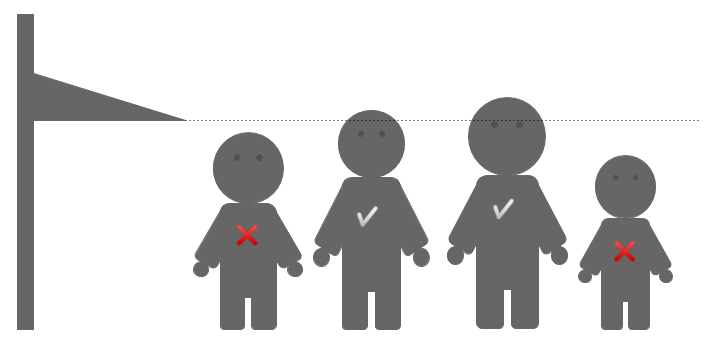

# Altura mínima



Avuí a l'escola fan una sortida al parc d'atraccions. La professora ha apuntat l'alçada de cada nen i nena, per veure qui podrà pujar a la muntanya russa i qui no.

## Input

L'entrada consta de tres parts:

- El primer nombre $N$ indica el nombre de nens i nenes (*int*)
- A continuació venen les seves alçades (*float*)
- Per últim, el nombre $M$ indica l'alçada mínima de la muntanya russa (*float*)

## Output

S'imprimirà `SI` o `NO` en una línia, per a cadascun dels nens i nenes

## Solutions

```java
void main() {
    Scanner sc = new Scanner(System.in);
    if (!sc.hasNextInt()) return;
    int n = sc.nextInt();
    double[] heights = new double[n];
    for (int i = 0; i < n; i++) {
        heights[i] = Double.parseDouble(sc.next());
    }
    double minHeight = Double.parseDouble(sc.next());
    for (int i = 0; i < n; i++) {
        if (heights[i] >= minHeight) {
            IO.println("SI");
        } else {
            IO.println("NO");
        }
    }
}
```

## Tests

### Test
```input
5
1.50   1.40   1.55   1.35   1.40

1.45
```
```output
SI
NO
SI
NO
NO
```

### Test
```input
3
1.30  1.40  1.50

1.40
```
```output
NO
SI
SI
```

### Test
```input
4
1.44  1.45  1.46  1.47

1.44
```
```output
SI
SI
SI
SI
```

### Test
```input
1
1.51

1.51
```
```output
SI
```

### Test
```input
10
1.46 1.43 1.56 1.57 1.50 1.51 1.39 1.45 1.60 1.47

1.50
```
```output
NO
NO
SI
SI
SI
SI
NO
NO
SI
NO
```

### Test private
```input
2
1.40 1.50

1.45
```
```output
NO
SI
```
