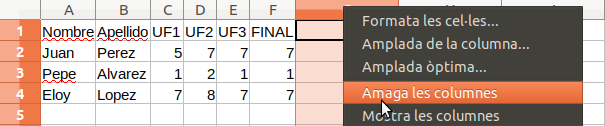

# Amaga les columnes



Els programes de Full de Càlcul solen tenir la funció d'amagar columnes.

Tractem d'implementar aquesta funcionalitat...

## Input

L'entrada consta en primer lloc d'un Full de càlcul:

- Els dos primers números $M$ i $N$ indiquen la quantitat de files i columnes
- A continuació ve la taula amb les dades (Les files separades per un salt de línia i les columnes separades per espai en blanc)

<p>En segon lloc venen les columnes que cal ocultar:

- S'inidica el número $C$ de columnes que s'han d'ocultar
- Després venen els índexs d'aquestes columnes (**començant per 1**)

## Output

S'imprimirà la taula, sense mostrar les columnes indicades.
Tots els camps de la taula han d'ocupar **10 espais i aliniats a l'esquerra**

## Tests

### Test
```input
4 6
Nombre  Apellidos T1  T2  T3  FINAL
Juan    Perez     5   6   6   6
Pepe    Alvarez   1   2   1   1
Eloy    Lopez     7   8   7   7

3
3 4 5
```
```output
Nombre    Apellidos FINAL     
Juan      Perez     6         
Pepe      Alvarez   1         
Eloy      Lopez     7      
```

### Test
```input
4 6
Nombre  Apellidos T1  T2  T3 FINAL
Juan    Perez     5   6   6   6
Pepe    Alvarez   1   2   1   1
Eloy    Lopez     7   8   7   7

1
2
```
```output
Nombre    T1        T2        T3        FINAL     
Juan      5         6         6         6         
Pepe      1         2         1         1         
Eloy      7         8         7         7  
```

### Test
```input
6 3
Columna1 Columna2 Columna3
Campo11  Campo12  Campo13
Campo21  Campo22  Campo23
Campo31  Campo32  Campo33
Campo41  Campo42  Campo43
Campo51  Campo52  Campo53

2
2 3
```
```output
Columna1  
Campo11   
Campo21   
Campo31   
Campo41   
Campo51  
```

### Test private
```input
6 3
Columna1 Columna2 Columna3
Campo11  Campo12  Campo13
Campo21  Campo22  Campo23
Campo31  Campo32  Campo33
Campo41  Campo42  Campo43
Campo51  Campo52  Campo53

2
1 3
```
```output
Columna2  
Campo12   
Campo22   
Campo32   
Campo42   
Campo52 
```
