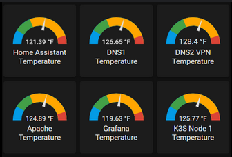

# Análisis estadístico de temperaturas



Dada una serie de temperaturas registradas en un día, realiza un análisis estadístico que incluya:

* La cantidad de mediciones
* La suma de todas las temperaturas
* La temperatura media
* La temperatura más alta
* La temperatura más baja
* El porcentaje de mediciones por debajo de la media
* El porcentaje de mediciones por encima de la media
* Si alguna medición coincide exactamente con la media

## Input

* Un número entero `N` que indica la cantidad de mediciones.
* A continuación vienen las `N` mediciones de temperatura.

## Output

Cantidad de mediciones: `entero`  
Suma total: `decimal`  
Temperatura media: `decimal`  
Temperatura máxima: `decimal`  
Temperatura mínima: `decimal`  
Porcentaje por debajo de la media: `decimal + %`  
Porcentaje por encima de la media: `decimal + %`  
Existe una temperatura igual a la media: `true | false`

## Solutions

```java
void main() {
    Scanner sc = new Scanner(System.in);
    if (!sc.hasNextInt()) return;
    int n = sc.nextInt();
    double[] temps = new double[n];
    double sum = 0;
    double max = 0;
    double min = 0;
    for (int i = 0; i < n; i++) {
        temps[i] = Double.parseDouble(sc.next());
        sum += temps[i];
        if (i == 0 || temps[i] > max) max = temps[i];
        if (i == 0 || temps[i] < min) min = temps[i];
    }
    double media = sum / n;
    int below = 0;
    int above = 0;
    boolean hasEqual = false;
    for (int i = 0; i < n; i++) {
        if (temps[i] < media) below++;
        else if (temps[i] > media) above++;
        else hasEqual = true;
    }
    double pctBelow = below * 100.0 / n;
    double pctAbove = above * 100.0 / n;

    IO.println("Cantidad de mediciones: " + n);
    IO.println("Suma total: " + sum);
    IO.println("Temperatura media: " + media);
    IO.println("Temperatura maxima: " + max);
    IO.println("Temperatura minima: " + min);
    IO.println("Porcentaje por debajo de la media: " + pctBelow + "%");
    IO.println("Porcentaje por encima de la media: " + pctAbove + "%");
    IO.println("Existe una temperatura igual a la media: " + hasEqual);
}
```

## Tests

### Test
```input
4 
4.0  7.0  5.0  6.0
```
```output
Cantidad de mediciones: 4
Suma total: 22.0
Temperatura media: 5.5
Temperatura maxima: 7.0
Temperatura minima: 4.0
Porcentaje por debajo de la media: 50.0%
Porcentaje por encima de la media: 50.0%
Existe una temperatura igual a la media: false
```

### Test
```input
1
15.5
```
```output
Cantidad de mediciones: 1
Suma total: 15.5
Temperatura media: 15.5
Temperatura maxima: 15.5
Temperatura minima: 15.5
Porcentaje por debajo de la media: 0.0%
Porcentaje por encima de la media: 0.0%
Existe una temperatura igual a la media: true
```

### Test
```input
5
20.0 20.0 20.0 20.0 20.0
```
```output
Cantidad de mediciones: 5
Suma total: 100.0
Temperatura media: 20.0
Temperatura maxima: 20.0
Temperatura minima: 20.0
Porcentaje por debajo de la media: 0.0%
Porcentaje por encima de la media: 0.0%
Existe una temperatura igual a la media: true
```

### Test
```input
4
-273.15
1000.0
0.0
50.0
```
```output
Cantidad de mediciones: 4
Suma total: 776.85
Temperatura media: 194.2125
Temperatura maxima: 1000.0
Temperatura minima: -273.15
Porcentaje por debajo de la media: 75.0%
Porcentaje por encima de la media: 25.0%
Existe una temperatura igual a la media: false
```

### Test
```input
5
0 0 0 0 10000
```
```output
Cantidad de mediciones: 5
Suma total: 10000.0
Temperatura media: 2000.0
Temperatura maxima: 10000.0
Temperatura minima: 0.0
Porcentaje por debajo de la media: 80.0%
Porcentaje por encima de la media: 20.0%
Existe una temperatura igual a la media: false
```
