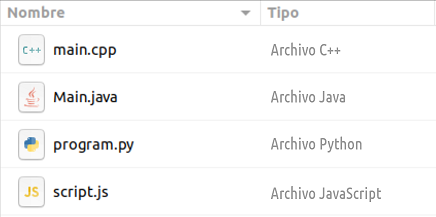

# Arxius de codi font



Cada llenguatge de programació té les seves pròpies extensions per als arxius de codi font.

Els de Java són `.java`, els JavaScript són `.js`, en Python és `py`, en C++ és `.cpp` ...

Donada una llista d'arxius amb el nom i tipus, imprimeix la llista en l'ordre invers, i les columnes intercanviades (primer tipus i després nom).

## Input

L'entrada consta de **quatre** línies.

En cada línia hi ha una paraula que es el $NOM$ de l'arxiu (amb l'extensió inclosa), y la resta de la línia és el $TIPUS$ d'arxiu.

## Output

S'imprimirà cada arxiu en una línia, primer el $TIPUS$ i després el $NOM$.

## Solutions

```java
void main() {
    Scanner sc = new Scanner(System.in);
    String[] names = new String[4];
    String[] types = new String[4];
    for (int i = 0; i < 4; i++) {
        if (!sc.hasNext()) return;
        names[i] = sc.next();
        types[i] = sc.nextLine().trim();
    }
    for (int i = 3; i >= 0; i--) {
        IO.println(types[i] + " " + names[i]);
    }
}
```

## Tests

### Test
```input
main.cpp Archivo C++
Main.java Archivo Java
program.py Archivo Python
script.js Archivo JavaScript
```
```output
Archivo JavaScript script.js 
Archivo Python program.py 
Archivo Java Main.java 
Archivo C++ main.cpp 
```

### Test
```input
index.php Archivo PHP
sample.cs Archivo C#
app.swift Archivo Swift
MainActivity.kt Archivo Kotlin
```
```output
Archivo Kotlin MainActivity.kt
Archivo Swift app.swift
Archivo C# sample.cs
Archivo PHP index.php
```

### Test private
```input
index.ts Archivo TypeScript
out.asm Archivo assembler
query.sql Archivo Structured Query Language
main.rs Archivo Rust
```
```output
Archivo Rust main.rs
Archivo Structured Query Language query.sql
Archivo assembler out.asm
Archivo TypeScript index.ts
```
