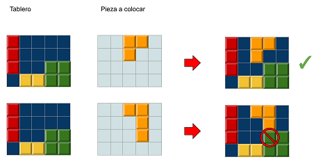
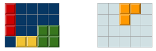

# Block Puzzle


En el juego Block Puzzle, el jugador va colocando unas piezas en el tablero completando filas o columnas. Las piezas no se pueden superponer.

Dado un tablero con las fichas que ya estaban colocadas, y otro tablero con la ficha que desea colocar el jugador, indica si la ficha se puede colocar en esa posición.



## Input

Los dos primeros números $M$ y $N$ indican el alto y ancho del tablero.

A continuación vienen las $MxN$ casillas del tablero (`1` significa que la casilla está ocupada y `0` que está libre).

A continación viene otro tablero de $MxN$ casillas, con la ficha que trata de poner el juagdor (`1` indica las casillas que ocupa la ficha).

## Output

Se imprimirá `true` si la ficha se puede colocar en esa posición, y `false` en caso contrario

## Solutions

```java
void main() {
    Scanner sc = new Scanner(System.in);
    if (!sc.hasNextInt()) return;
    int h = sc.nextInt();
    int w = sc.nextInt();

    int[][] board = new int[h][w];
    for (int r = 0; r < h; r++) {
        for (int c = 0; c < w; c++) {
            board[r][c] = sc.nextInt();
        }
    }

    boolean fits = true;
    for (int r = 0; r < h; r++) {
        for (int c = 0; c < w; c++) {
            int piece = sc.nextInt();
            if (piece == 1 && board[r][c] == 1) {
                fits = false;
            }
        }
    }

    IO.println(fits);
}
```

## Tests

### Test
```input
4 5

1 0 0 0 0
1 0 0 0 0
1 0 0 1 1
0 1 1 1 1

0 0 1 1 0
0 0 1 0 0
0 0 0 0 0
0 0 0 0 0
```
```output
true
```
#### Explanation


### Test
```input
4 3

1 1 0
1 1 0
0 0 0
1 1 1

0 0 0
0 0 0
0 1 1
0 1 1
```
```output
false
```
#### Explanation


### Test
```input
5 5

0 1 1 0 1
0 1 0 0 1
0 1 0 0 1
0 0 0 1 1
0 0 0 1 1

0 0 0 0 0
0 0 0 0 0
1 1 1 0 0
1 1 1 0 0
1 1 1 0 0
```
```output
false
```

### Test
```input
2 3

0 1 1
0 0 1

1 0 0
1 1 0
```
```output
true
```

### Test private
```input
4 6

1 1 1 1 0 1
1 1 1 0 0 1
1 1 1 1 0 1
0 0 0 0 0 1

0 0 0 0 1 0
0 0 0 1 1 0
0 0 0 0 1 0
0 0 0 0 0 0
```
```output
true
```
#### Explanation
true
