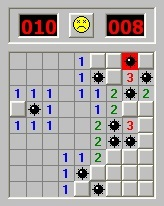

# Cercant mines

Donat un tauler de buscamines i certes posicions, dir si en aquestes posicions hi ha o no una mina.



## Input

L'entrada consta en primer lloc de dos números $M$ i $N$ que indiquen el tamany del tauler ($M$ = files, $N$ = columnes).

A continuació venen les $MxN$ caselles del tauler (0, 1).

Seguidament venen les posicions en les que s'ha de comprovar si hi ha mina.
Cada posició consta de dos números que indiquen la fila $F$ i la columna $C$ que s'ha de comprovar. **Les posicions comencen per 1** (ja que és la forma en què es jugaria el joc).

Les posicions a comprovar acaben amb `0 0`.

## Output

Per cada posició a comprovar s'escriurà `SI` si en la casella hi ha una mina i `NO` si no hi ha.

## Solutions

```java
void main() {
    Scanner sc = new Scanner(System.in);
    if (!sc.hasNextInt()) return;
    int rows = sc.nextInt();
    int cols = sc.nextInt();

    int[][] board = new int[rows][cols];
    for (int r = 0; r < rows; r++) {
        for (int c = 0; c < cols; c++) {
            board[r][c] = sc.nextInt();
        }
    }

    while (sc.hasNextInt()) {
        int r = sc.nextInt();
        int c = sc.nextInt();
        if (r == 0 && c == 0) break;
        if (board[r - 1][c - 1] == 1) {
            IO.println("SI");
        } else {
            IO.println("NO");
        }
    }
}
```

## Tests

### Test
```input
3 3
1 0 0
0 0 0
0 0 0
1 1
2 2
0 0
```
```output
SI
NO
```

### Test
```input
3 3

1 0 0
0 0 0
0 0 1

1 1
2 2
3 3
0 0
```
```output
SI
NO
SI
```

### Test
```input
5 5

0 1 0 0 0
0 0 0 0 1
0 1 0 0 1
0 0 1 1 0
0 0 1 1 0

1 1
1 2
3 4
3 5
5 3
0 0
```
```output
NO
SI
NO
SI
SI
```

### Test
```input
1 1

1

1 1
0 0
```
```output
SI
```

### Test
```input
1 4

0 0 0 0

1 1
1 2
1 3
1 4
0 0
```
```output
NO
NO
NO
NO
```

### Test private
```input
3 4

0 1 0 0
0 0 0 1
0 1 1 0

1 3
3 4
3 2
0 0
```
```output
NO
NO
SI
```
