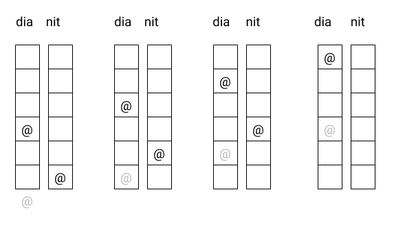
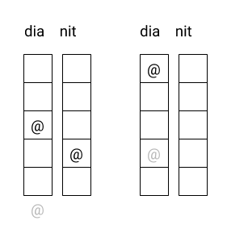
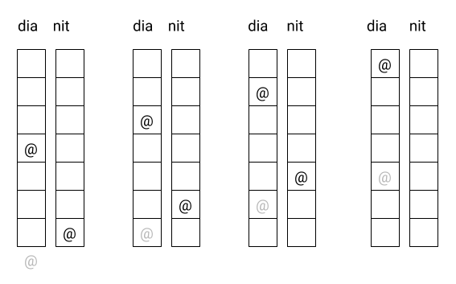

# Cargol

Un cargol vol trepar un pal d'una alçada d'$H$ metres. 
Si puja $A$ metres durant el dia, però rellisca $B$ metres avall per la nit, en quin dia aconseguirà arribar a dalt de tot?

## Input

Tres números enters positius: $H$, $A$ i $B$

## Output

El número de dia en què aconseguirà arribar a dalt de tot

## Plantillas

```java
void main(String[] args) {
    Scanner scanner = new Scanner(System.in);
      
    int h = scanner.nextInt();
    int a = scanner.nextInt();
    int b = scanner.nextInt();

    // write your code here
}
```

## Solutions

```java
void main() {
    Scanner sc = new Scanner(System.in);
    int h = sc.nextInt();
    int a = sc.nextInt();
    int b = sc.nextInt();

    int pos = 0;
    int day = 0;
    while (true) {
        day++;
        pos += a;
        if (pos >= h) {
            break;
        }
        pos -= b;
    }
    IO.println(day);
}
```

## Tests

### Test
```input
6 3 2
```
```output
4
```
#### Explanation


### Test
```input
5 3 1
```
```output
2
```
#### Explanation


### Test
```input
7 4 3
```
```output
4
```
#### Explanation


### Test
```input
6 4 2
```
```output
2
```

### Test
```input
9 4 2
```
```output
4
```

### Test
```input
13 5 3
```
```output
5
```

### Test private
```input
 12 4 1
```
```output
4
```
