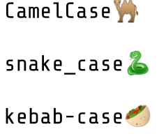

# CaSe StYlEs

Existeixen nombroses convencions a l'hora d'escollir la seqüència de caracters que s'usa com a identificador de variables, tipus, funcions, ...

Normalment, a cada llenguatge hi ha unes convencions, encara que cada organització té el seu propi estil.

Les més comuns són: 

- `CamelCase` : Java, C#, Javascript, Go, Ruby, JSON
- `snake_case` : Python, PHP, C, C++
- `kebab-case` : Lisp, XML



## Input

Les paraules que componen l'identificador

## Output

S'escriurà l'identificador en CamelCase, snake_case i kebab-case.

En CamelCase cada paraula comença en majúscules, i no es separen amb espais.

En snake_case les paraules es separen amb `_` i es posen en majúscules si totes les lletres són majúscules. Si hi ha alguna lletra minúscula, es posen totes les lletres en minúscula.

En kebab-case totes les lletres van sempre en minúscula, i separades amb `-`

## Solutions

```java
void main() {
    Scanner sc = new Scanner(System.in);
    String input = "";
    while (sc.hasNextLine()) {
        String l = sc.nextLine();
        if (!l.isEmpty()) {
            if (!input.isEmpty()) {
                input += " ";
            }
            input += l;
        }
    }
    String[] words = input.trim().split("\\s+");

    // 1. CamelCase
    String camel = "";
    for (int i = 0; i < words.length; i++) {
        String w = words[i];
        if (!w.isEmpty()) {
            camel += w.substring(0, 1).toUpperCase() + w.substring(1).toLowerCase();
        }
    }

    // 2. kebab-case
    String kebab = "";
    for (int i = 0; i < words.length; i++) {
        if (i > 0) {
            kebab += "-";
        }
        kebab += words[i].toLowerCase();
    }

    // 3. snake_case
    boolean allUpper = true;
    for (int i = 0; i < input.length(); i++) {
        char c = input.charAt(i);
        if (c >= 'a' && c <= 'z') {
            allUpper = false;
            break;
        }
    }

    String snake = "";
    for (int i = 0; i < words.length; i++) {
        if (i > 0) {
            snake += "_";
        }
        if (allUpper) {
            snake += words[i].toUpperCase();
        } else {
            snake += words[i].toLowerCase();
        }
    }

    IO.println(camel);
    IO.println(kebab);
    IO.println(snake);
}
```

## Tests

### Test
```input
case styles
```
```output
CaseStyles
case-styles
case_styles
```

### Test
```input
case styles
```
```output
CaseStyles
case-styles
case_styles
```

### Test
```input
CASE STYLES
```
```output
CaseStyles
case-styles
CASE_STYLES
```

### Test
```input
CAsE STYLES
```
```output
CaseStyles
case-styles
case_styles
```

### Test
```input
Fork join worker thread factory
```
```output
ForkJoinWorkerThreadFactory
fork-join-worker-thread-factory
fork_join_worker_thread_factory
```

### Test private
```input
abstract transactional data source spring context tests
```
```output
AbstractTransactionalDataSourceSpringContextTests
abstract-transactional-data-source-spring-context-tests
abstract_transactional_data_source_spring_context_tests
```
