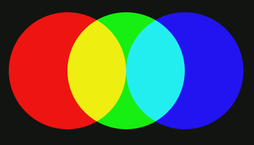
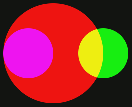
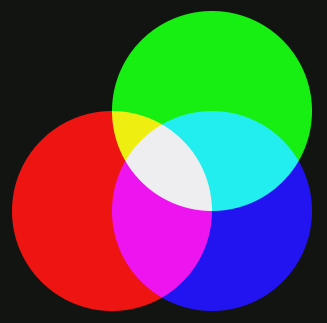
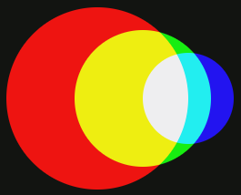
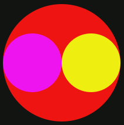

# Cercles RGB

RGB és un model de color additiu en el qual la llum vermella, verda i blava son mesclades per a reproduir colors. És el model que s'usa en pantalles, projectors, càmeres o scànners.


Fem un experiment emetent sobre una pared tres focus rodons -de diferents tamanys i posicions- de llum vermella, verda i blava.

¿Quants colors distints veurem?

## Input

La entrada consisteix en la definició dels 3 cercles RGB. 

Cada cercle es defineix per les coordinades del seu centre ($X$, $Y$)
i la longitud del seu radi $R$.

## Output

El nombre de colors distints que es veuran.

## Solutions

```java
void main() {
    Scanner sc = new Scanner(System.in);
    double x1 = Double.parseDouble(sc.next());
    double y1 = Double.parseDouble(sc.next());
    double r1 = Double.parseDouble(sc.next());

    double x2 = Double.parseDouble(sc.next());
    double y2 = Double.parseDouble(sc.next());
    double r2 = Double.parseDouble(sc.next());

    double x3 = Double.parseDouble(sc.next());
    double y3 = Double.parseDouble(sc.next());
    double r3 = Double.parseDouble(sc.next());

    double minX = Math.min(x1 - r1, Math.min(x2 - r2, x3 - r3));
    double maxX = Math.max(x1 + r1, Math.max(x2 + r2, x3 + r3));
    double minY = Math.min(y1 - r1, Math.min(y2 - r2, y3 - r3));
    double maxY = Math.max(y1 + r1, Math.max(y2 + r2, y3 + r3));

    boolean[] seen = new boolean[8];
    int steps = 500;
    double r1Sq = r1 * r1;
    double r2Sq = r2 * r2;
    double r3Sq = r3 * r3;

    double dx = (maxX - minX) / steps;
    double dy = (maxY - minY) / steps;

    for (int i = 0; i < steps; i++) {
        double x = minX + (i + 0.5) * dx;
        for (int j = 0; j < steps; j++) {
            double y = minY + (j + 0.5) * dy;

            boolean in1 = (x - x1) * (x - x1) + (y - y1) * (y - y1) < r1Sq;
            boolean in2 = (x - x2) * (x - x2) + (y - y2) * (y - y2) < r2Sq;
            boolean in3 = (x - x3) * (x - x3) + (y - y3) * (y - y3) < r3Sq;

            int mask = (in1 ? 1 : 0) | (in2 ? 2 : 0) | (in3 ? 4 : 0);
            seen[mask] = true;
        }
    }

    int count = 0;
    for (int k = 1; k < 8; k++) {
        if (seen[k]) {
            count++;
        }
    }

    IO.println(count);
}
```

## Tests

### Test
```input
0 0 1
1 0 1
2 0 1
```
```output
5
```
#### Explanation


### Test
```input
0 0 1
1 0 1
2 0 1
```
```output
5
```
#### Explanation


### Test
```input
0 0 1
1 0 1
3 0 1
```
```output
4
```
#### Explanation


### Test
```input
0 0 1
2 0 1
4 0 1
```
```output
3
```
#### Explanation


### Test
```input
1 0 4
2 0 2
0 0 2
```
```output
4
```
#### Explanation


### Test
```input
1 0 2
3 0 1
0 0 1
```
```output
4
```
#### Explanation


### Test
```input
0 1 1
1 0 1
1 1 1
```
```output
7
```
#### Explanation


### Test
```input
0 0 4
4 0 3
4 0 2
```
```output
5
```
#### Explanation


### Test
```input
0 0 4
0 0 3
0 0 2
```
```output
3
```
#### Explanation


### Test
```input
0 0 4
2 0 3
2 0 1
```
```output
4
```
#### Explanation


### Test
```input
0 0 4
2 0 3
4 0 2
```
```output
6
```
#### Explanation


### Test
```input
0 0 4
6 0 4
3 0 2
```
```output
6
```
#### Explanation


### Test
```input
0 4 4
6 2 3
5 6 2
```
```output
6
```
#### Explanation


### Test private
```input
2 0 4
4 0 2
0 0 2
```
```output
3
```
