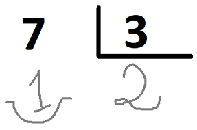

# Corregint els deures

A un alumne li han manat de deures fer un munt de divisions. Quan les ha acabades li demana a son pare si li pot ajudar a corregir-les. El pare, que té molt de treball i no té temps per a corregir divisions, decideix programar una intel·ligència artificial per a que les corregeixi en el seu lloc. Usant una tècnica de Reconeixement Òptic de Caracters, aconsegueix digitalitzar les divisions. 

Per exemple, de la següent divisió



es digitalitza el **Dividend**, el **Divisor**, el **Quocient** i el **Residu**, i s'obté:

```
7 3 2 1
```

No obstant, el pare no és capac d'implementar un programa que, un cop digitalitzades les divisions, digui si són o no correctes. ¿Podries ajudar-lo?

El programa haurà de dir quines divisions són incorrectes, i donar el seu resultat correcte.

## Input

L'entrada consta de $N$ divisions.

Per a cada divisió s'indiquen el $Dividend$, $Divisor$, $Quocient$ i $Residu$.

L'entrada acaba amb quatre zeros.

## Output

De les divisions incorrectes, el programa haurà de mostrar el número de divisió, i el resultat correcte (quocient i residu), separades per un salt de línia i amb el següent format:

```
número) quocient residu
```

## Solutions

```java
void main() {
    Scanner sc = new Scanner(System.in);
    int divIndex = 1;
    while (sc.hasNextInt()) {
        int dividend = sc.nextInt();
        int divisor = sc.nextInt();
        int quotient = sc.nextInt();
        int remainder = sc.nextInt();

        if (dividend == 0 && divisor == 0 && quotient == 0 && remainder == 0) {
            break;
        }

        int correctQuotient = dividend / divisor;
        int correctRemainder = dividend % divisor;

        if (quotient != correctQuotient || remainder != correctRemainder) {
            IO.println(divIndex + ") " + correctQuotient + " " + correctRemainder);
        }
        divIndex++;
    }
}
```

## Tests

### Test
```input
2 2 1 0
4 2 5 7
6 3 2 0
0 0 0 0
```
```output
2) 2 0
```
#### Explanation
La segunda división **2)** es incorrecta, el resultado correcto es cociente **2** y residuo **0**.

### Test
```input
10 5 3 4
5 1 5 0
6 4 2 0
15 3 5 0
0 0 0 0
```
```output
1) 2 0
3) 1 2
```
#### Explanation
La primera división **1)** es incorrecta y el resultado correcto es cociente **2** y residuo **0**.

La tercera división **3)** es incorrecta y el resultado correcto es cociente **1** y residuo **2**.

### Test
```input
33 10 3 3
12 11 1 1
0 0 0 0
```
```output
```
#### Explanation
Todas las divisiones son correctas

### Test
```input
0 5 0 5
24 1 0 24
0 0 0 0
```
```output
1) 0 0
2) 24 0
```
#### Explanation
La primera división **1)** es incorrecta. El cociente es **0** y el residuo **0**.

La segunda división **2)** es incorrecta. El cociente es **24** y el residuo **0**.

### Test
```input
2 4 3 5
0 4 0 0
0 4 8 0
0 4 0 8
3 4 0 0
1 4 5 0
0 0 0 0
```
```output
1) 0 2
3) 0 0
4) 0 0
5) 0 3
6) 0 1
```

### Test private
```input
1 1 1 0
0 0 0 0
```
```output
```
