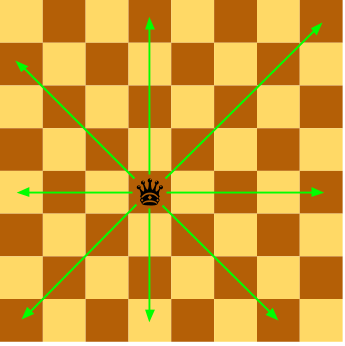
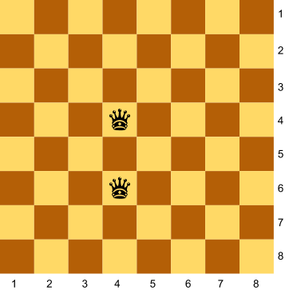
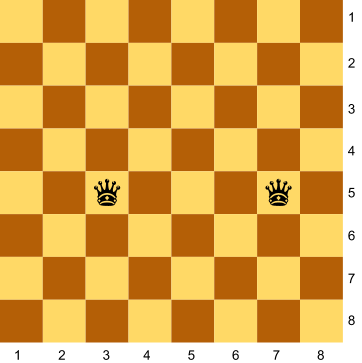
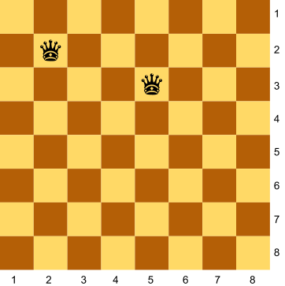
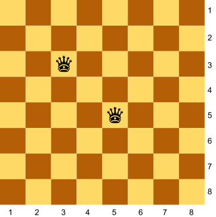
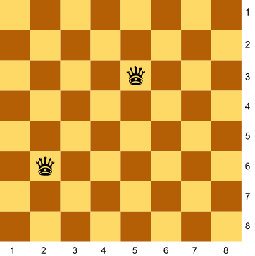
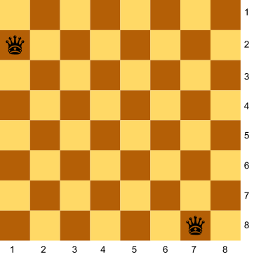
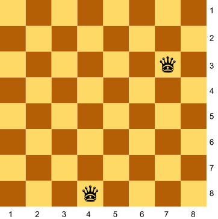

# Dues reines

Donades les posicions de les dues reines en un tauler d'escacs, digues si s'amenacen mútuament.



## Input

La entrada consisteix en 4 nombres indicant la $FILA$ i $COLUMNA$ de cada reina

## Output

`true` | `false`

## Solutions

```java
void main() {
    Scanner sc = new Scanner(System.in);
    int r1 = sc.nextInt();
    int c1 = sc.nextInt();
    int r2 = sc.nextInt();
    int c2 = sc.nextInt();
    boolean attacks = (r1 == r2 || c1 == c2 || Math.abs(r1 - r2) == Math.abs(c1 - c2));
    IO.println(attacks);
}
```

## Tests

### Test
```input
4 4
6 6
```
```output
true
```
#### Explanation


### Test
```input
3 5
7 5
```
```output
true
```
#### Explanation


### Test
```input
2 2
5 3
```
```output
false
```
#### Explanation


### Test
```input
3 3
5 5
```
```output
true
```
#### Explanation


### Test
```input
5 5
3 3
```
```output
true
```
#### Explanation


### Test
```input
2 6
5 3
```
```output
true
```
#### Explanation


### Test
```input
5 3
2 6
```
```output
true
```
#### Explanation


### Test
```input
1 2
7 8
```
```output
true
```
#### Explanation


### Test
```input
7 8
1 2
```
```output
true
```
#### Explanation


### Test private
```input
4 8
7 3
```
```output
false
```
#### Explanation

