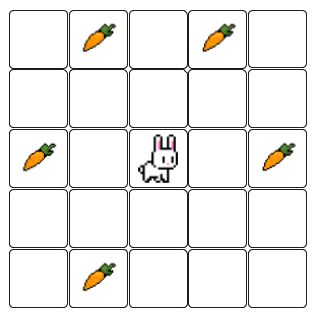
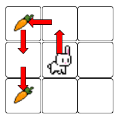
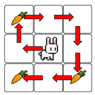
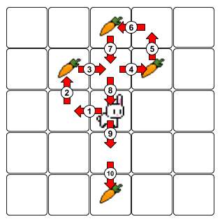

# El conill i les pastanagues



Ajuda al conill a menjar-se la pastanagues!

El conill es troba inicialment en el centre de la graella, i es pot moure en les quatre direccions, una casella cada vegada. 

Quants moviments necessita per a menjar-se totes les pastanagues **en l'ordre correcte**?

## Input

En primer lloc ve un nombre imparell $N$ que indica el tamany de la graella: $NxN$
A continuació ve la graella. Les pastanagues estan indicades amb el número d'ordre en què s'han de menjar.

## Output

S'escriurà el nombre de moviments que necessita el conill per a menjar-se totes les pastanagues en l'ordre correcte.

## Solutions

```java
void main() {
    Scanner sc = new Scanner(System.in);
    if (!sc.hasNextInt()) return;
    int n = sc.nextInt();
    int[] carrotR = new int[n * n + 1];
    int[] carrotC = new int[n * n + 1];
    int maxCarrot = 0;
    for (int r = 0; r < n; r++) {
        for (int c = 0; c < n; c++) {
            int val = sc.nextInt();
            if (val > 0) {
                carrotR[val] = r;
                carrotC[val] = c;
                if (val > maxCarrot) {
                    maxCarrot = val;
                }
            }
        }
    }
    int currR = n / 2;
    int currC = n / 2;
    int totalMoves = 0;
    for (int step = 1; step <= maxCarrot; step++) {
        totalMoves += Math.abs(carrotR[step] - currR) + Math.abs(carrotC[step] - currC);
        currR = carrotR[step];
        currC = carrotC[step];
    }
    IO.println(totalMoves);
}
```

## Tests

### Test
```input
3
1 0 0
0 0 0
2 0 0
```
```output
4
```
#### Explanation


### Test
```input
3
1 0 0
0 0 0
3 0 2
```
```output
8
```
#### Explanation


### Test
```input
5
0 0 3 0 0
0 1 0 2 0
0 0 0 0 0
0 0 0 0 0
0 0 4 0 0
```
```output
10
```
#### Explanation


### Test
```input
5
0 0 0 0 0
0 2 3 4 0
0 1 0 5 0
0 8 7 6 0
0 0 0 0 0
```
```output
8
```

### Test
```input
5
0 0 0 0 0
0 3 2 4 0
0 1 0 6 0
0 8 7 5 0
0 0 0 0 0
```
```output
12
```

### Test
```input
9
10  0  5  0  0  0  0  0 12
 0  0  0  0  0  4  0  0  0
 0  0  0  0  0  0  0  0  7
 1  0  0  0  0  0  0  0  0
 0  0  0  0  0  0 11  0  0
 0  0  0  0  0  0  0  0  0
 0  0  0  6  0  0  2  0  0
 0  3  0  0  0  0  0  0  0
 8  0  0  0  0  0  0  0  9
```
```output
104
```

### Test private
```input
3
4 0 3
0 0 0
2 0 1
```
```output
10
```
