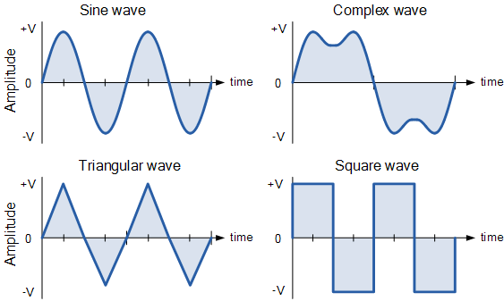

# Generador de corrent


Per a comprovar el funcionament d'un generador de corrent elèctrica alterna, es mesura periòdicament el voltatge de la corrent generada.

Es considera que el generador funciona correctament si el voltatge alterna pujades i baixades. És a dir, si en una medició el voltatge ha pujat, en la següent ha d'haver baixat, i viceversa.

La primera medició respecte de la segona ha de ser de pujada.

## Input

La entrada consisteix en una seqüència de números que representen els voltages mesurats.

La seqüència acaba amb un 0, que no s'ha de computar.

## Output

S'imprimirà "CORRECTE" si la seqüència de números ha anat alternant pujades i baixades, i "INCORRECTE" en cas contrari.

## Solutions

```java
void main() {
    Scanner sc = new Scanner(System.in);
    if (!sc.hasNextInt()) return;
    int prev = sc.nextInt();
    if (prev == 0) {
        IO.println("INCORRECTE");
        return;
    }

    boolean correct = true;
    boolean expectUp = true;
    int count = 1;

    while (sc.hasNextInt()) {
        int current = sc.nextInt();
        if (current == 0) break;
        count++;
        if (expectUp) {
            if (current <= prev) {
                correct = false;
            }
        } else {
            if (current >= prev) {
                correct = false;
            }
        }
        expectUp = !expectUp;
        prev = current;
    }

    if (count < 2) {
        correct = false;
    }

    if (correct) {
        IO.println("CORRECTE");
    } else {
        IO.println("INCORRECTE");
    }
}
```

## Tests

### Test
```input
1 5 2 7 3   0
```
```output
CORRECTE
```

### Test
```input
2 5 3 6 7   0
```
```output
INCORRECTE
```

### Test
```input
3 1 3 1 3    0
```
```output
INCORRECTE
```
#### Explanation
La primera i la segona medició no són de pujada

### Test private
```input
4 4 3 6 3   0
```
```output
INCORRECTE
```
