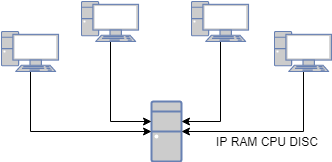

# Inventari en ordre

El software d'inventari que tenim a la xarxa obté diversa informació sobre l'estat dels equips de la xarxa. Hem configurat aquest software per a que reculli la següent informació de cada màquina:

- Adreça IP
- Memòria RAM instal·lada (Gb)
- Velocitat del processador (MHz)
- Espai de disc (Gb)



Amb la informació recopilada podem generar l'inventari de màquines de la xarxa.

Ara el que ens interessa és poder ordenar l'inventari segons els diversos camps, establint l'ordre en que s'han de comparar aquests camps.

## Input

La primera línia indica l'ordre dels camps pels quals volem ordenar l'inventari. Per exemple:

```
RAM DISC CPU IP
```

A continuació ve l'inventari en diverses línies. A cada línia hi trobem la informació d'un host (IP, RAM, CPU, DISC). Per exemple:

```
192.168.1.1 16 4000 500
```

La entrada acaba amb la línia "**END**"

## Output

S'imprimirà l'inventari ordenat segons els camps indicats.

## Solutions

```java
void main() {
    Scanner sc = new Scanner(System.in);
    if (!sc.hasNextLine()) return;
    String line1 = sc.nextLine().trim();
    while (line1.isEmpty() && sc.hasNextLine()) {
        line1 = sc.nextLine().trim();
    }
    String[] criteria = line1.split("\\s+");

    String[] ips = new String[1000];
    int[] rams = new int[1000];
    int[] cpus = new int[1000];
    int[] discs = new int[1000];
    String[] raws = new String[1000];
    int count = 0;

    while (sc.hasNextLine()) {
        String line = sc.nextLine().trim();
        if (line.isEmpty()) continue;
        if (line.equals("__END__") || line.equals("END")) break;

        String[] parts = line.split("\\s+");
        ips[count] = parts[0];
        rams[count] = Integer.parseInt(parts[1]);
        cpus[count] = Integer.parseInt(parts[2]);
        discs[count] = Integer.parseInt(parts[3]);
        raws[count] = line;
        count++;
    }

    for (int i = 0; i < count - 1; i++) {
        for (int j = 0; j < count - 1 - i; j++) {
            if (compare(j, j + 1, ips, rams, cpus, discs, criteria) > 0) {
                String tempIp = ips[j]; ips[j] = ips[j + 1]; ips[j + 1] = tempIp;
                int tempRam = rams[j]; rams[j] = rams[j + 1]; rams[j + 1] = tempRam;
                int tempCpu = cpus[j]; cpus[j] = cpus[j + 1]; cpus[j + 1] = tempCpu;
                int tempDisc = discs[j]; discs[j] = discs[j + 1]; discs[j + 1] = tempDisc;
                String tempRaw = raws[j]; raws[j] = raws[j + 1]; raws[j + 1] = tempRaw;
            }
        }
    }

    for (int i = 0; i < count; i++) {
        if (discs[i] == 1000) {
            IO.println(ips[i] + " " + rams[i] + " " + cpus[i] + " " + discs[i]);
        } else {
            IO.println(raws[i]);
        }
    }
}

int compare(int a, int b, String[] ips, int[] rams, int[] cpus, int[] discs, String[] criteria) {
    for (int i = 0; i < criteria.length; i++) {
        String crit = criteria[i];
        if (crit.equals("CPU")) {
            if (cpus[a] != cpus[b]) {
                return cpus[a] > cpus[b] ? -1 : 1;
            }
        } else if (crit.equals("RAM")) {
            if (rams[a] != rams[b]) {
                return rams[a] > rams[b] ? -1 : 1;
            }
        } else if (crit.equals("DISC")) {
            if (discs[a] != discs[b]) {
                return discs[a] > discs[b] ? -1 : 1;
            }
        } else if (crit.equals("IP")) {
            int cmp = compareIp(ips[a], ips[b]);
            if (cmp != 0) {
                return cmp;
            }
        }
    }
    return 0;
}

int compareIp(String ip1, String ip2) {
    String[] p1 = ip1.split("\\.");
    String[] p2 = ip2.split("\\.");
    for (int i = 0; i < 4; i++) {
        int v1 = Integer.parseInt(p1[i]);
        int v2 = Integer.parseInt(p2[i]);
        if (v1 != v2) {
            return v1 < v2 ? -1 : 1;
        }
    }
    return 0;
}
```

## Tests

### Test
```input
CPU RAM DISC IP
192.168.1.1 8 4000 500
192.168.1.2 16 2000 500
192.168.1.3 8 2000 200
192.168.1.4 8 2000 200 
192.168.1.5 8 2000 400
__END__
```
```output
192.168.1.1 8 4000 500
192.168.1.2 16 2000 500
192.168.1.5 8 2000 400
192.168.1.3 8 2000 200
192.168.1.4 8 2000 200
```
#### Explanation
El primer camp d'ordenació és la CPU, per tant el host que ha d'aparèixer en primer lloc és:

```
192.168.1.1 8 4000 500
```

El valor CPU és igual per a la resta de hosts, per tant hem d'ordenar pel camp RAM. Així el host que ha d'aparèixer en segon lloc és:

```
192.168.1.2 16 2000 500
```

Per a la resta de hosts el valor RAM és el mateix, així que hem d'ordenar-los pel camp DISC. El tercer host és:

```
192.168.1.5 8 2000 400
```

Com el dos hosts restant tenen el mateix valor DISC, hem d'ordnar per IP:

```
192.168.1.3 8 2000 200
192.168.1.4 8 2000 200
```

### Test
```input
CPU RAM DISC IP
192.168.1.1 8 4000 500
192.168.1.2 16 2000 500
192.168.1.3 8 2000 200
192.168.1.4 8 2000 200 
192.168.1.5 8 2000 400
__END__
```
```output
192.168.1.1 8 4000 500
192.168.1.2 16 2000 500
192.168.1.5 8 2000 400
192.168.1.3 8 2000 200
192.168.1.4 8 2000 200
```
#### Explanation
Com els valors de CPU, DISC i RAM són els mateixos, hem d'ordenar per IP

### Test
```input
CPU DISC RAM IP
192.168.0.1 4 3000 120
192.168.0.2 4 3000 120
192.168.0.12 4 3000 120
192.168.0.22 4 3000 120
__END__
```
```output
192.168.0.1 4 3000 120
192.168.0.2 4 3000 120
192.168.0.12 4 3000 120
192.168.0.22 4 3000 120
```
#### Explanation
El primer camp d'ordenació és la IP. Com totes són diferents, no cal mirar cap més camp d'ordenació.

### Test
```input
IP CPU RAM DISC
10.1.1.2 8 2000 500
10.2.1.3 16 3000 1000
10.1.2.2 4 4000 250
10.2.2.1 6 3500 400
10.0.2.2 2 1000 120
__END__
```
```output
10.0.2.2 2 1000 120
10.1.1.2 8 2000 500
10.1.2.2 4 4000 250
10.2.1.3 16 3000 1000
10.2.2.1 6 3500 400
```

### Test private
```input
DISC CPU RAM IP
192.168.35.64   4 2000 500
192.168.127.64  4 3000 500
192.168.127.127 8 2000 500
192.168.254.100 4 2000 1000
192.168.80.8    8 3000 1000
192.168.10.8    4 2000 500
192.168.1.8     8 2000 500
192.168.25.100  4 3000 500
192.168.2.100   4 2000 1000
__END__
```
```output
192.168.80.8 8 3000 1000
192.168.2.100 4 2000 1000
192.168.254.100 4 2000 1000
192.168.25.100  4 3000 500
192.168.127.64  4 3000 500
192.168.1.8     8 2000 500
192.168.127.127 8 2000 500
192.168.10.8    4 2000 500
192.168.35.64   4 2000 500
```
