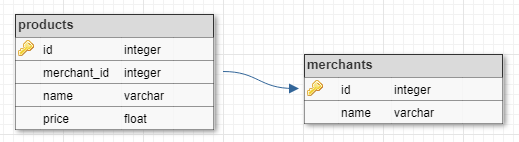

# JOIN

Donades les tuples de les següents relacions:



Realitza la següent consulta:

```
SELECT name, merchants.name AS merchant, price 
FROM products 
    JOIN merchants ON product.merchant_id = merchants.id
```

## Input

La entrada consisteix en les tuples per a les taules 'products', 'merchants'.
En primer lloc va el nombre de tuples i després les tuples, cadascuna en una línia.

Per a la taula **products** el format de cada tupla és:

```
id id_merchant nom price
```

Per a la taula **merchants** el format és:

```
id nom
```

## Output

La sortida serà el resultat de la consulta en format taula:

```
name            |merchant        |price     
----------------+----------------+----------
```

L'amplada de les columnes 'name' i 'merchant' és 16, i la 'price' és 10. El preu s'haurà de posar amb dos decimals. 

Tot el text s'ha d'aliniar a l'esquerra.

Per últim caldrà indicar el número de tuples retornades per la consulta: "(X rows)"

## Solutions

```java
void main() {
    Scanner sc = new Scanner(System.in);
    if (!sc.hasNextInt()) return;
    int numProd = sc.nextInt();
    int[] prodId = new int[numProd];
    int[] prodMerchantId = new int[numProd];
    String[] prodName = new String[numProd];
    double[] prodPrice = new double[numProd];

    for (int i = 0; i < numProd; i++) {
        prodId[i] = sc.nextInt();
        prodMerchantId[i] = sc.nextInt();
        prodName[i] = sc.next();
        prodPrice[i] = Double.parseDouble(sc.next());
    }

    int numMerchants = sc.nextInt();
    int[] merchId = new int[numMerchants];
    String[] merchName = new String[numMerchants];

    for (int i = 0; i < numMerchants; i++) {
        merchId[i] = sc.nextInt();
        merchName[i] = sc.nextLine().trim();
    }

    IO.println("%-16s|%-16s|%-10s".formatted("name", "merchant", "price"));
    IO.println("----------------+----------------+----------");

    int rows = 0;
    for (int i = 0; i < numProd; i++) {
        for (int j = 0; j < numMerchants; j++) {
            if (prodMerchantId[i] == merchId[j]) {
                IO.println("%-16s|%-16s|%10.2f".formatted(prodName[i], merchName[j], prodPrice[i]));
                rows++;
                break;
            }
        }
    }

    IO.println("(%d rows)".formatted(rows));
}
```

## Tests

### Test
```input
3
1 1 Java 0
7 6 Gnome 0
10 6 gcc 0

2
1 Oracle
6 GNU
```
```output
name            |merchant        |price     
----------------+----------------+----------
Java            |Oracle          |      0.00
Gnome           |GNU             |      0.00
gcc             |GNU             |      0.00
(3 rows)
```

### Test
```input
3
1 1 Java 0
7 6 Gnome 0
10 6 gcc 0

2
1 Oracle
6 GNU
```
```output
name            |merchant        |price     
----------------+----------------+----------
Java            |Oracle          |      0.00
Gnome           |GNU             |      0.00
gcc             |GNU             |      0.00
(3 rows)
```

### Test
```input
1
14 8 Firefox 0

2
2 Microsoft
8 Mozilla
```
```output
name            |merchant        |price     
----------------+----------------+----------
Firefox         |Mozilla         |      0.00
(1 rows)
```

### Test
```input
9
7 6 Gnome 0
8 6 Gimp 0
9 6 Guix 0
10 6 gcc 0
11 7 Apache 0
12 7 Hadoop 0
13 7 Spark 0
14 8 Firefox 0
15 9 PostgreSQL 0

1
4 Apple
```
```output
name            |merchant        |price     
----------------+----------------+----------
(0 rows)
```

### Test
```input
1
10 6 gcc 0

9
1 Oracle
2 Microsoft
3 Google
4 Apple
5 Adobe
6 GNU
7 Apache SF
8 Mozilla
9 PGDB
```
```output
name            |merchant        |price     
----------------+----------------+----------
gcc             |GNU             |      0.00
(1 rows)
```

### Test private
```input
15
1 1 Java 0
2 1 OracleDB 109.4
3 2 Windows 37.3
4 3 Android 0
5 4 OSX 74.1
6 5 Photoshop 55
7 6 Gnome 0
8 6 Gimp 0
9 6 Guix 0
10 6 gcc 0
11 7 Apache 0
12 7 Hadoop 0
13 7 Spark 0
14 8 Firefox 0
15 9 PostgreSQL 0

9
1 Oracle
2 Microsoft
3 Google
4 Apple
5 Adobe
6 GNU
7 Apache SF
8 Mozilla
9 PGDB
```
```output
name            |merchant        |price     
----------------+----------------+----------
Java            |Oracle          |      0.00
OracleDB        |Oracle          |    109.40
Windows         |Microsoft       |     37.30
Android         |Google          |      0.00
OSX             |Apple           |     74.10
Photoshop       |Adobe           |     55.00
Gnome           |GNU             |      0.00
Gimp            |GNU             |      0.00
Guix            |GNU             |      0.00
gcc             |GNU             |      0.00
Apache          |Apache SF       |      0.00
Hadoop          |Apache SF       |      0.00
Spark           |Apache SF       |      0.00
Firefox         |Mozilla         |      0.00
PostgreSQL      |PGDB            |      0.00
(15 rows)
```
