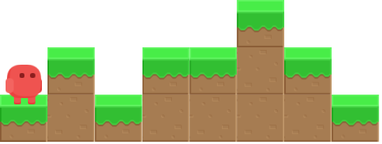
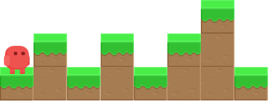
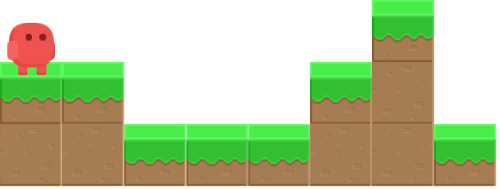
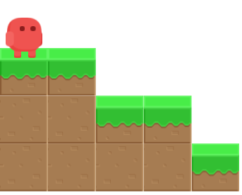
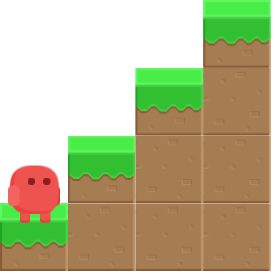

# Jump, jump!

En un joc de plataformes, el personatge ha d'anar fent salts per a poder avançar. En la situació següent, per exemple, haurà de fer 3 salts per a arribar al final:



Podem entendre el mapa del joc com una succesió de nombres que indiquen l'altura del terreny. En el cas anterior es podria definir com:

```
1 2 1 2 2 3 2 1
```

En cada salt, el personatge pot avançar només 1 casella.

## Input

La entrada consta d'una successió de N nombres que indiquen l'altura H del terreny . La successió acaba amb un -1 (que no s'ha tenir en compte).

## Output

S'imprimirà el nombre mínim de salts que necessita donar per a arribar al final.

## Solutions

```java
void main() {
    Scanner sc = new Scanner(System.in);
    if (!sc.hasNextInt()) return;
    int prev = sc.nextInt();
    if (prev == -1) {
        IO.println(0);
        return;
    }
    int jumps = 0;
    while (sc.hasNextInt()) {
        int curr = sc.nextInt();
        if (curr == -1) break;
        if (curr > prev) {
            jumps++;
        }
        prev = curr;
    }
    IO.println(jumps);
}
```

## Tests

### Test
```input
1 2 1 2 2 3 2 1   -1
```
```output
3
```
#### Explanation


### Test
```input
1 2 1 2 1 2 3 1   -1
```
```output
4
```
#### Explanation


### Test
```input
2 2 1 1 1 2 3 1   -1
```
```output
2
```
#### Explanation


### Test
```input
3 3 2 2 1   -1
```
```output
0
```
#### Explanation


### Test
```input
1 2 3 4   -1
```
```output
3
```
#### Explanation


### Test
```input
1   -1
```
```output
0
```

### Test
```input
1 2 3 4 1 2 3 4 5 6 7 8 1   -1
```
```output
10
```

### Test private
```input
9 5 1 2 3 1 2  -1
```
```output
3
```
