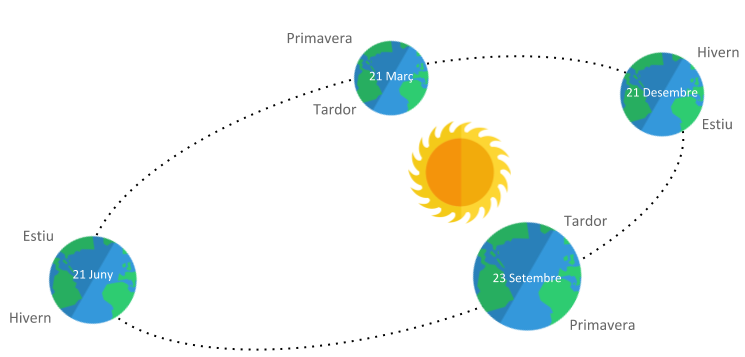

# Les quatre estacions

Les quatre estacions tradicionals tenen el seu inici i final marcats per esdeveniments astronòmics:

- Hivern: entre el solstici d'hivern i l'equinocci de primavera.
- Primavera: entre l'equinocci de primavera i el solstici d'estiu.
- Estiu: entre el solstici d'estiu i l'equinocci de tardor.
- Tardor: entre l'equinocci de tardor i el solstici d'hivern.

A l'hemisferi sud hivern-estiu i primavera-tardor estan invertits



## Input

La entrada consta d'un dia i mes de l'any.

## Output

S'imprimirà l'estació corresponent a l'hemisferi nord i a l'hemisferi sud.

## Solutions

```java
void main() {
    Scanner sc = new Scanner(System.in);
    if (!sc.hasNextInt()) return;
    int day = sc.nextInt();
    int month = sc.nextInt();

    int date = month * 100 + day;

    String north;
    String south;

    if (date >= 321 && date < 621) {
        north = "Primavera";
        south = "Tardor";
    } else if (date >= 621 && date < 923) {
        north = "Estiu";
        south = "Hivern";
    } else if (date >= 923 && date < 1221) {
        north = "Tardor";
        south = "Primavera";
    } else {
        north = "Hivern";
        south = "Estiu";
    }

    IO.println(north);
    IO.println(south);
}
```

## Tests

### Test
```input
21 3
```
```output
Primavera
Tardor
```

### Test
```input
21 12
```
```output
Hivern
Estiu
```

### Test
```input
21 3
```
```output
Primavera
Tardor
```

### Test
```input
21 6
```
```output
Estiu
Hivern
```

### Test
```input
23 9
```
```output
Tardor
Primavera
```

### Test
```input
20 12
```
```output
Tardor
Primavera
```

### Test
```input
22 12
```
```output
Hivern
Estiu
```

### Test
```input
20 3
```
```output
Hivern
Estiu
```

### Test
```input
22 3
```
```output
Primavera
Tardor
```

### Test
```input
20 6
```
```output
Primavera
Tardor
```

### Test
```input
22 6
```
```output
Estiu
Hivern
```

### Test
```input
22 9
```
```output
Estiu
Hivern
```

### Test
```input
24 9
```
```output
Tardor
Primavera
```

### Test
```input
15 1
```
```output
Hivern
Estiu
```

### Test
```input
23 5
```
```output
Primavera
Tardor
```

### Test
```input
21 7
```
```output
Estiu
Hivern
```

### Test
```input
27 10
```
```output
Tardor
Primavera
```

### Test private
```input
30 1
```
```output
Hivern
Estiu
```
