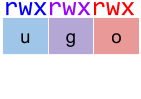

# Permisos rwx UNIX

Els permisos de lecture, escritura i execució sobre fitxers en sistemes UNIX-like són gestionats en tres classes: usuari, grup i altres.

Els fitxers són propietat d'un usuari i d'un grup, i s'especifiquen permisos per a les tres classes: propietari del fitxer, els usuaris del grup propietari del fitxer i la resta d'usuaris.



Quan un usuari tracta d'accedir a un fitxer, els permisos efectius que té sobre el fitxer es determinen en base a la primera classe en la qual encaixi.

Donats els permisos, i l'usuari i grup propietaris d'un fitxer, calcula els permisos efectius que tindrà un usuari determinat sobre un fitxer.

## Input

A la primera línia venen els 9 permisos P, separats per espais en blanc, i l'usuari i grup propietaris.

A la segona línia ve l'usuari que tracta d'accedir al fitxer, i els 3 grups als que pertany.

## Output

S'imprimiran els permisos efectius

## Solutions

```java
void main() {
    Scanner sc = new Scanner(System.in);
    if (!sc.hasNext()) return;
    String u1 = sc.next();
    String u2 = sc.next();
    String u3 = sc.next();
    String g1 = sc.next();
    String g2 = sc.next();
    String g3 = sc.next();
    String o1 = sc.next();
    String o2 = sc.next();
    String o3 = sc.next();
    String fileOwner = sc.next();
    String fileGroup = sc.next();

    String userPerms = u1 + u2 + u3;
    String groupPerms = g1 + g2 + g3;
    String otherPerms = o1 + o2 + o3;

    String accessingUser = sc.next();
    String grp1 = sc.next();
    String grp2 = sc.next();
    String grp3 = sc.next();

    if (accessingUser.equals(fileOwner)) {
        IO.println(userPerms);
    } else if (fileGroup.equals(grp1) || fileGroup.equals(grp2) || fileGroup.equals(grp3)) {
        IO.println(groupPerms);
    } else {
        IO.println(otherPerms);
    }
}
```

## Tests

### Test
```input
r w x r - x r - - root root
alumne1 alumnes informatica dam
```
```output
r--
```

### Test
```input
r w x r - x r - - root root
alumne1 alumnes informatica dam
```
```output
r--
```

### Test
```input
r w - r w - - - - root alumnes
alumne1 alumnes informatica asix
```
```output
rw-
```

### Test
```input
r w x r - x r - - root root
alumne1 alumnes informatica dam
```
```output
r--
```

### Test
```input
r w - r - - - - - alumne2 dam
alumne1 alumnes informatica asix
```
```output
---
```

### Test
```input
r w x r w - r - - alumne3 asix
alumne2 alumnes informatica asix
```
```output
rw-
```

### Test
```input
r w x r w - r - - alumne3 root
alumne3 root informatica asix
```
```output
rwx
```

### Test
```input
r w x r w - r - - alumne3 root
alumne3 root informatica asix
```
```output
rwx
```

### Test private
```input
r w x r w x r - - root root
alumne3 root informatica asix
```
```output
rwx
```
