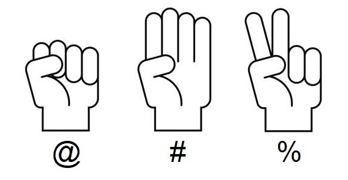

# Pedra, Paper, Tisora



Donades un sèrie de rondes del joc Pedra-Paper-Tisora, determina el guanyador de la partida.

## Input

Cada ronda de la partida s'indica en una línia diferent.

En cada ronda el primer caracter indica la ma treta pel jugador 1, i el segon caracter la ma treta pel jugador 2.

- El caracter @ significa "Pedra"
- El caracter # significa "Paper"
- El caracter % significa "Tisora"

El final de la partida es marca amb "END".

## Output

S'imprimirà '1' si guanya el jugador 1, i '2' si ho fa el jugador 2.
Si hi ha empat s'imprimirà '-'.

## Solutions

```java
void main() {
    Scanner sc = new Scanner(System.in);
    int p1Score = 0;
    int p2Score = 0;
    
    while (sc.hasNext()) {
        String round = sc.next();
        if (round.equals("END")) {
            break;
        }
        char c1 = round.charAt(0);
        char c2 = round.charAt(1);
        
        if (c1 != c2) {
            if ((c1 == '@' && c2 == '%') || (c1 == '%' && c2 == '#') || (c1 == '#' && c2 == '@')) {
                p1Score++;
            } else {
                p2Score++;
            }
        }
    }
    
    if (p1Score > p2Score) {
        IO.println(1);
    } else if (p2Score > p1Score) {
        IO.println(2);
    } else {
        IO.println("-");
    }
}
```

## Tests

### Test
```input
@%
#@
%#
END
```
```output
1
```
#### Explanation
La primera ronda el JUGADOR1 trau PEDRA (@) i el JUGADOR2 trau TISORA (%) => 1 punt per a JUGADOR1.

En la segona ronda el JUGADOR1 trau PAPER (#) i el JUGADOR2 trau PEDRA (@) => 1 punt per a JUGADOR1.

En la tercera ronda el JUGADOR1 trau TISORA (%) i el JUGADOR2 trau PAPER (#) => 1 punt per a JUGADOR1.

El resultat final és JUGADOR1 = 3 punts i JUGADOR2 = 0 punts. Guanya JUGADOR1

### Test
```input
@#
@%
@@
@%
END
```
```output
1
```

### Test
```input
#@
#%
#%
##
END
```
```output
2
```

### Test
```input
%#
%%
#%
%#
END
```
```output
1
```

### Test
```input
@%
@%
@%
@%
@%
END
```
```output
1
```

### Test
```input
#%
@#
%@
END
```
```output
2
```

### Test
```input
@@
END
```
```output
-
```

### Test
```input
@@
##
%%
END
```
```output
-
```

### Test
```input
@#
#@
@%
%@
END
```
```output
-
```

### Test
```input
@%
@#
@@
%@
#@
@@
END
```
```output
-
```

### Test
```input
@%
END
```
```output
1
```

### Test
```input
#@
#%
@#
%#
%#
%@
#%
@@
@#
%#
#%
%%
##
%@
END
```
```output
2
```

### Test private
```input
##
@@
%%
END
```
```output
-
```
