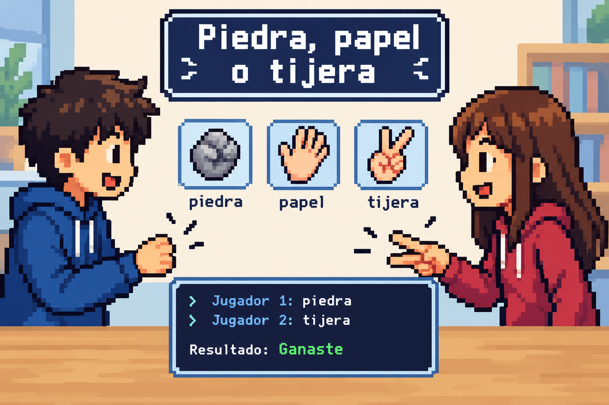

# Piedra, papel o tijera



Escribe un programa que simule una partida de **piedra, papel o tijera** entre dos jugadores.

El programa debe pedir al primer jugador que elija una mano y después pedir al segundo jugador que elija su mano. Las opciones válidas son:

- `piedra`
- `papel`
- `tijera`

Después, el programa debe indicar si el primer jugador ha **ganado**, **perdido** o ha habido **empate**.

Si alguno de los jugadores escribe una opción que no sea válida, el programa debe mostrar un mensaje indicando que la mano es desconocida.

## Entrada

El programa debe leer dos cadenas de texto:

1. La mano elegida por el primer jugador.
2. La mano elegida por el segundo jugador.

Cada mano debe ser `piedra`, `papel` o `tijera`.

## Salida

Imprime una línea con el resultado de la partida:

- `Resultado: Empate` si ambos jugadores han elegido la misma mano.
- `Resultado: Ganaste` si la mano del primer jugador gana a la del segundo.
- `Resultado: Perdiste` si la mano del primer jugador pierde contra la del segundo.
- `Resultado: Mano desconocida: ¡elige piedra, papel o tijera!` si alguna de las manos no es válida.

Las reglas son las habituales:

- La piedra gana a la tijera.
- La tijera gana al papel.
- El papel gana a la piedra.

## Solutions

```java
void main() {
    Scanner sc = new Scanner(System.in);
    if (!sc.hasNext()) return;
    String p1 = sc.next();
    if (!sc.hasNext()) return;
    String p2 = sc.next();

    boolean p1Valid = p1.equals("piedra") || p1.equals("papel") || p1.equals("tijera");
    boolean p2Valid = p2.equals("piedra") || p2.equals("papel") || p2.equals("tijera");

    if (!p1Valid || !p2Valid) {
        IO.println("Resultado: Mano desconocida: ¡elige piedra, papel o tijera!");
    } else if (p1.equals(p2)) {
        IO.println("Resultado: Empate");
    } else if ((p1.equals("piedra") && p2.equals("tijera"))
            || (p1.equals("tijera") && p2.equals("papel"))
            || (p1.equals("papel") && p2.equals("piedra"))) {
        IO.println("Resultado: Ganaste");
    } else {
        IO.println("Resultado: Perdiste");
    }
}
```

## Tests

### Test
```input
piedra
tijera
```
```output
Resultado: Ganaste
```

### Test
```input
tijera
papel
```
```output
Resultado: Ganaste
```

### Test
```input
papel
piedra
```
```output
Resultado: Ganaste
```

### Test
```input
tijera
piedra
```
```output
Resultado: Perdiste
```

### Test
```input
papel
tijera
```
```output
Resultado: Perdiste
```

### Test
```input
piedra
papel
```
```output
Resultado: Perdiste
```

### Test
```input
piedra
piedra
```
```output
Resultado: Empate
```

### Test
```input
papel
papel
```
```output
Resultado: Empate
```

### Test
```input
tijera
tijera
```
```output
Resultado: Empate
```

### Test
```input
lagarto
piedra
```
```output
Resultado: Mano desconocida: ¡elige piedra, papel o tijera!
```

### Test
```input
piedra
lagarto
```
```output
Resultado: Mano desconocida: ¡elige piedra, papel o tijera!
```

### Test
```input
lagarto
spock
```
```output
Resultado: Mano desconocida: ¡elige piedra, papel o tijera!
```
