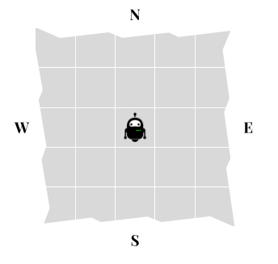
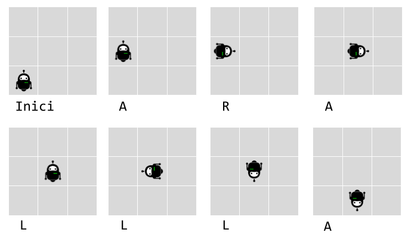
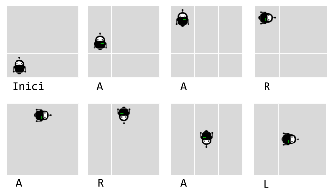
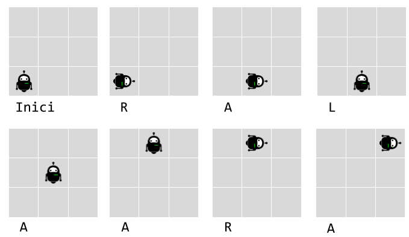
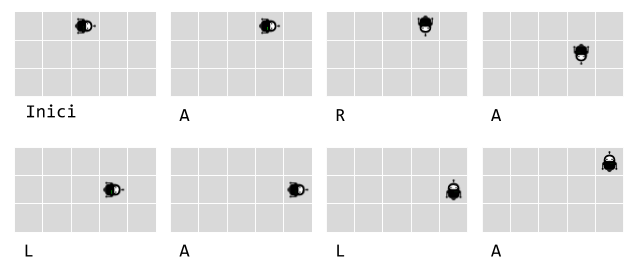

# Robot simulator

La instal·lació de proves d'una fàbrica de robots necessita un programa per verificar els moviments del robot.

Els robots tenen tres possibles moviments:

- gir a la dreta (R)
- gir a l'esquerra (L)
- avançar (A)

Els robots es col loquen en una xarxa hipotètica infinita, orientats cap a una direcció particular (N, S, E, W}.
 


Aleshores el robot rep diverses instruccions, moment en què la instal·lació de proves verifica la nova posició del robot i en quina direcció apunta.

Per exemple, la cadena de lletres `ARALLLA` significa:

- Avançar (`A`)
- Gir a la dreta (`R`)
- Avançar (`A`)
- Gir a l'esquerra x3 (`LLL`)
- Avançar (`A`)

Digueu que un robot comença a {0, 0} mirant al nord. A continuació, executar aquest flux d'instruccions hauria de deixar-lo a {1, 0} mirant al sud.



## Input

La entrada consisteix en:

Dos nombres $X,Y$ indicant les coordenades de la posició inicial.

Un caràcter $O$ indicant la orientació inicial.

Una cadena de $L$ caràcters amb les instruccions

## Output

S'imprimiran les coordenades finals `{X, Y}` i la orientació `O` en que queda el robot

## Solutions

```java
void main() {
    Scanner sc = new Scanner(System.in);
    int x = sc.nextInt();
    int y = sc.nextInt();
    String dirStr = sc.next();
    String inst = sc.hasNext() ? sc.next() : "";

    int d = switch (dirStr.charAt(0)) {
        case 'N' -> 0;
        case 'E' -> 1;
        case 'S' -> 2;
        default -> 3;
    };

    for (int i = 0; i < inst.length(); i++) {
        char c = inst.charAt(i);
        if (c == 'R') {
            d = (d + 1) % 4;
        } else if (c == 'L') {
            d = (d + 3) % 4;
        } else if (c == 'A') {
            if (d == 0) y++;
            else if (d == 1) x++;
            else if (d == 2) y--;
            else if (d == 3) x--;
        }
    }

    char outDir = switch (d) {
        case 0 -> 'N';
        case 1 -> 'E';
        case 2 -> 'S';
        default -> 'W';
    };

    IO.println("{%d, %d}".formatted(x, y));
    IO.println(outDir);
}
```

## Tests

### Test
```input
0 0
N
ARALLLA
```
```output
{1, 0}
S
```

### Test
```input
0 0
N
AARARAL
```
```output
{1, 1}
E
```
#### Explanation


### Test
```input
0 0
N
RALAARA
```
```output
{2, 2}
E
```
#### Explanation


### Test
```input
2 2
E
ARALALA
```
```output
{4, 2}
N
```
#### Explanation


### Test
```input
3 1
E
LARLAAR
```
```output
{3, 4}
E
```

### Test
```input
-1 -2
S
AAA
```
```output
{-1, -5}
S
```

### Test
```input
17 -3
E
AAALAAA
```
```output
{20, 0}
N
```

### Test
```input
20 10
W
ALARLARLARRARRR
```
```output
{19, 8}
W
```

### Test private
```input
134 -33
S
ALARRLAAALRLLAARLAARLLLARRRALARLRLALLLRAALRALRALLRAAALRAALR
```
```output
{141, -36}
E
```
