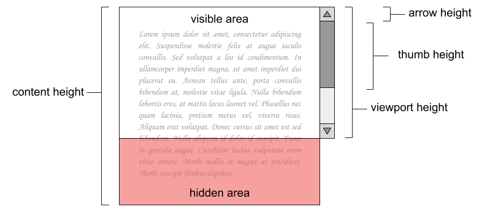

# Scrollbar

Quan el *content height* és major que el *viewport height*, el navegador web mostra una *scrollbar* amb dues *arrows* i un *thumb* per a poder desplaçar el contingut.



Per cada píxel que es desplaça el *thumb*, el contingut es desplaça proporcionalment en direcció oposada.

Per a implementar una *scrollbar* és necessari calcular el *thumb height* (de forma que el segment de desplaçament i el *thumb* mantenguin la proporció amb el *viewport* i el contingut) i el desplaçament del contingut per cada píxel que es desplaça el *thumb* (*scroll jump*).

## Input

La entrada consisteix en tres nombres:

- viewport height
- content height
- arrow height

## Output

S'imprimirà el *thumb height* i el *scroll jump*, arrodonits sense decimals.

## Solutions

```java
void main() {
    Scanner sc = new Scanner(System.in);
    if (!sc.hasNextDouble()) return;
    double vh = sc.nextDouble();
    double ch = sc.nextDouble();
    double ah = sc.nextDouble();

    double trackHeight = vh - 2 * ah;
    double thumbHeight = trackHeight * (vh / ch);
    double scrollJump = (ch - vh) / (trackHeight - thumbHeight);

    IO.println(Math.round(thumbHeight));
    IO.println(Math.round(scrollJump));
}
```

## Tests

### Test
```input
100 300 20
```
```output
20
5
```

### Test
```input
100 200 25
```
```output
25
4
```

### Test
```input
100 250 25
```
```output
20
5
```

### Test
```input
100 300 20
```
```output
20
5
```

### Test private
```input
100 320 10
```
```output
25
4
```
