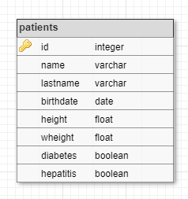

# SELECT

Donades les tuples de la següent relació:



Realitza les següents consultes:

```
SELECT * 
    FROM patients
```

```
SELECT * 
    FROM patients 
    WHERE LOWER(name) LIKE %pa% OR LOWER(lastname) LIKE %er%
```

```
SELECT name, lastname, birthdate 
    FROM patients 
    WHERE birthdate BETWEEN '1707-04-15' AND '1937-12-26'
```

```
SELECT name, lastname, weight/height^2 AS ims
    FROM patients 
    WHERE weight/height^2 < 18.5
```

```
SELECT name, lastname, weight/height^2 AS ims
    FROM patients 
    WHERE weight/height^2 > 25 AND (diabetes IS TRUE || hepatitis IS TRUE)
```

## Input

El primer nombre indica el la quantitat de tuples que venen a continuació.

El format de cada tupla és:

```
id lastname, name, birthdate, height, weight, diabetes, hepatitis
```

Els valors de l'atribut birthdate estan en format 'YYYY-MM-DD'

Els booleans s'expresen amb {0|1}

En les dades d'entrada poden haver diversos espais en blanc entre els diferents atributs.

## Output

El format de sortida serà en format taula:

```
col1   |col2   |col3
-------+-------+-------
val    |val    |val
val    |val    |val
```

Els noms de les columnes s'aliniaran a l'esquerra.

El format dels valors ha de ser:

- Integer: amplada 4, aliniat a l'esquerra
- String: amplada 16, aliniat a l'esquerra
- Data: amplada 12, aliniat a la dreta
- Float: amplada 10, aliniat a la dreta, amb dues xifres decimals
- Boolean: amplada 10, aliniat a la dreta, {true|false}

S'ha de deixar una separació de 2 salts de línia entre cada resultat.

## Solutions

```java
int compareDate(String d1, String d2) {
    if (d1.startsWith("-") && !d2.startsWith("-")) return -1;
    if (!d1.startsWith("-") && d2.startsWith("-")) return 1;
    if (d1.length() != d2.length()) return d1.length() - d2.length();
    for (int i = 0; i < d1.length(); i++) {
        if (d1.charAt(i) != d2.charAt(i)) {
            return d1.charAt(i) - d2.charAt(i);
        }
    }
    return 0;
}

void main() {
    Scanner sc = new Scanner(System.in);
    if (!sc.hasNextInt()) return;
    int n = sc.nextInt();
    sc.nextLine();

    int[] ids = new int[n];
    String[] lastnames = new String[n];
    String[] names = new String[n];
    String[] birthdates = new String[n];
    double[] heights = new double[n];
    double[] weights = new double[n];
    boolean[] diabetes = new boolean[n];
    boolean[] hepatitis = new boolean[n];
    double[] ims = new double[n];

    for (int i = 0; i < n; i++) {
        String line = sc.nextLine().trim();
        while (line.length() == 0) {
            line = sc.nextLine().trim();
        }
        String[] parts = line.split(",");
        String p0 = parts[0].trim();
        int spaceIdx = -1;
        for (int j = 0; j < p0.length(); j++) {
            if (p0.charAt(j) == ' ') {
                spaceIdx = j;
                break;
            }
        }
        ids[i] = Integer.parseInt(p0.substring(0, spaceIdx));
        lastnames[i] = p0.substring(spaceIdx + 1).trim();
        names[i] = parts[1].trim();
        birthdates[i] = parts[2].trim();
        heights[i] = Double.parseDouble(parts[3].trim());
        weights[i] = Double.parseDouble(parts[4].trim());
        diabetes[i] = parts[5].trim().equals("1");
        hepatitis[i] = parts[6].trim().equals("1");
        ims[i] = weights[i] / (heights[i] * heights[i]);
    }

    // Query 1: SELECT * FROM patients
    IO.println("id  |name            |lastname        |birthdate   |height  |wheight |diabetes  |hepatitis ");
    IO.println("----+----------------+----------------+------------+--------+--------+----------+----------");
    for (int i = 0; i < n; i++) {
        IO.println("%-4d|%-16s|%-16s|%12s|%8.2f|%8.2f|%10s|%10s".formatted(
            ids[i], names[i], lastnames[i], birthdates[i], heights[i], weights[i],
            diabetes[i] ? "true" : "false", hepatitis[i] ? "true" : "false"
        ));
    }

    IO.println();

    // Query 2: SELECT * FROM patients WHERE LOWER(name) LIKE %pa% OR LOWER(lastname) LIKE %er%
    IO.println("id  |name            |lastname        |birthdate   |height  |wheight |diabetes  |hepatitis ");
    IO.println("----+----------------+----------------+------------+--------+--------+----------+----------");
    for (int i = 0; i < n; i++) {
        if (names[i].toLowerCase().contains("pa") || lastnames[i].toLowerCase().contains("er")) {
            IO.println("%-4d|%-16s|%-16s|%12s|%8.2f|%8.2f|%10s|%10s".formatted(
                ids[i], names[i], lastnames[i], birthdates[i], heights[i], weights[i],
                diabetes[i] ? "true" : "false", hepatitis[i] ? "true" : "false"
            ));
        }
    }

    IO.println();

    // Query 3: SELECT name, lastname, birthdate FROM patients WHERE birthdate BETWEEN '1707-04-15' AND '1937-12-26'
    IO.println("name            |lastname        |birthdate   ");
    IO.println("----------------+----------------+------------");
    for (int i = 0; i < n; i++) {
        if (compareDate(birthdates[i], "1707-04-15") >= 0 && compareDate(birthdates[i], "1937-12-26") <= 0) {
            IO.println("%-16s|%-16s|%12s".formatted(names[i], lastnames[i], birthdates[i]));
        }
    }

    IO.println();

    // Query 4: SELECT name, lastname, weight/height^2 AS ims FROM patients WHERE weight/height^2 < 18.5
    IO.println("name            |lastname        |ims     ");
    IO.println("----------------+----------------+--------");
    for (int i = 0; i < n; i++) {
        if (ims[i] < 18.5) {
            IO.println("%-16s|%-16s|%8.2f".formatted(names[i], lastnames[i], ims[i]));
        }
    }

    IO.println();

    // Query 5: SELECT name, lastname, weight/height^2 AS ims FROM patients WHERE weight/height^2 > 25 AND (diabetes IS TRUE || hepatitis IS TRUE)
    IO.println("name            |lastname        |ims     ");
    IO.println("----------------+----------------+--------");
    for (int i = 0; i < n; i++) {
        if (ims[i] > 25.0 && (diabetes[i] || hepatitis[i])) {
            IO.println("%-16s|%-16s|%8.2f".formatted(names[i], lastnames[i], ims[i]));
        }
    }
}
```

## Plantillas

```java
import java.io.*;
import java.util.*;
import java.text.*;
import java.math.*;
import java.util.regex.*;

import java.time.LocalDate;
import java.time.format.DateTimeFormatter;

public class Main {

    public static void main(String[] args) {
        /*
        DateTimeFormatter dtf = DateTimeFormatter.ofPattern("uuuu-M-d");
        
        LocalDate ini = LocalDate.parse("1707-04-15", dtf);
        LocalDate fi = LocalDate.parse("1937-12-26", dtf);
        LocalDate birthdate = LocalDate.parse("1845-03-03", dtf);

        if(!(birthdate.isAfter(fi) || birthdate.isBefore(ini))){
            System.out.println("birthdate BETWEEN '1707-04-15' AND '1937-12-26'");
        }
        */
    }
}
```

## Tests

### Test
```input
10
1 of Samos,   Pyhtagoras, -0570-01-01, 1.75, 63.2, 0, 0
2   of Alexandria,  Hypatia, 0350-01-01, 1.59, 46.1,  0, 1
 3  Cardano,  Gerolamo, 1501-09-24, 1.73,  69.2,   1, 0
  4  Euler,    Leonhard,   1707-04-15,    1.64,  59.9, 1, 1
5 Gauss, Carl, 1777-04-30, 1.70, 92.2, 1, 0
6 Cantor,   Georg, 1845-03-03,    1.75, 75.2, 0, 0
 7    Erdos, Paul,     1913-03-26, 1.76, 56.6,  1,    1
 8 Conway, John, 1937-12-26, 1.72, 88.2, 0, 1
9 Perelman, Grigori,    1966-06-13, 1.90, 89.9, 1,   1
  10 Tao, Terry, 1975-07-17,  1.74, 68.4, 0, 0
```
```output
id  |name            |lastname        |birthdate   |height  |wheight |diabetes  |hepatitis 
----+----------------+----------------+------------+--------+--------+----------+----------
1   |Pyhtagoras      |of Samos        | -0570-01-01|    1.75|   63.20|     false|     false
2   |Hypatia         |of Alexandria   |  0350-01-01|    1.59|   46.10|     false|      true
3   |Gerolamo        |Cardano         |  1501-09-24|    1.73|   69.20|      true|     false
4   |Leonhard        |Euler           |  1707-04-15|    1.64|   59.90|      true|      true
5   |Carl            |Gauss           |  1777-04-30|    1.70|   92.20|      true|     false
6   |Georg           |Cantor          |  1845-03-03|    1.75|   75.20|     false|     false
7   |Paul            |Erdos           |  1913-03-26|    1.76|   56.60|      true|      true
8   |John            |Conway          |  1937-12-26|    1.72|   88.20|     false|      true
9   |Grigori         |Perelman        |  1966-06-13|    1.90|   89.90|      true|      true
10  |Terry           |Tao             |  1975-07-17|    1.74|   68.40|     false|     false

id  |name            |lastname        |birthdate   |height  |wheight |diabetes  |hepatitis 
----+----------------+----------------+------------+--------+--------+----------+----------
2   |Hypatia         |of Alexandria   |  0350-01-01|    1.59|   46.10|     false|      true
4   |Leonhard        |Euler           |  1707-04-15|    1.64|   59.90|      true|      true
7   |Paul            |Erdos           |  1913-03-26|    1.76|   56.60|      true|      true
9   |Grigori         |Perelman        |  1966-06-13|    1.90|   89.90|      true|      true

name            |lastname        |birthdate   
----------------+----------------+------------
Leonhard        |Euler           |  1707-04-15
Carl            |Gauss           |  1777-04-30
Georg           |Cantor          |  1845-03-03
Paul            |Erdos           |  1913-03-26
John            |Conway          |  1937-12-26

name            |lastname        |ims     
----------------+----------------+--------
Hypatia         |of Alexandria   |   18.24
Paul            |Erdos           |   18.27

name            |lastname        |ims     
----------------+----------------+--------
Carl            |Gauss           |   31.90
John            |Conway          |   29.81
```

### Test private
```input
10
1 of Samos,   Pyhtagoras, -0570-01-01, 1.75, 63.2, 0, 0
2   of Alexandria,  Hypatia, 0350-01-01, 1.59, 46.1,  0, 1
 3  Cardano,  Gerolamo, 1501-09-24, 1.73,  69.2,   1, 0
  4  Euler,    Leonhard,   1707-04-15,    1.64,  59.9, 1, 1
5 Gauss, Carl, 1777-04-30, 1.70, 92.2, 1, 0
6 Cantor,   Georg, 1845-03-03,    1.75, 75.2, 0, 0
 7    Erdos, Paul,     1913-03-26, 1.76, 56.6,  1,    1
 8 Conway, John, 1937-12-26, 1.72, 88.2, 0, 1
9 Perelman, Grigori,    1966-06-13, 1.90, 89.9, 1,   1
  10 Tao, Terry, 1975-07-17,  1.74, 68.4, 0, 0
```
```output
id  |name            |lastname        |birthdate   |height  |wheight |diabetes  |hepatitis 
----+----------------+----------------+------------+--------+--------+----------+----------
1   |Pyhtagoras      |of Samos        | -0570-01-01|    1.75|   63.20|     false|     false
2   |Hypatia         |of Alexandria   |  0350-01-01|    1.59|   46.10|     false|      true
3   |Gerolamo        |Cardano         |  1501-09-24|    1.73|   69.20|      true|     false
4   |Leonhard        |Euler           |  1707-04-15|    1.64|   59.90|      true|      true
5   |Carl            |Gauss           |  1777-04-30|    1.70|   92.20|      true|     false
6   |Georg           |Cantor          |  1845-03-03|    1.75|   75.20|     false|     false
7   |Paul            |Erdos           |  1913-03-26|    1.76|   56.60|      true|      true
8   |John            |Conway          |  1937-12-26|    1.72|   88.20|     false|      true
9   |Grigori         |Perelman        |  1966-06-13|    1.90|   89.90|      true|      true
10  |Terry           |Tao             |  1975-07-17|    1.74|   68.40|     false|     false

id  |name            |lastname        |birthdate   |height  |wheight |diabetes  |hepatitis 
----+----------------+----------------+------------+--------+--------+----------+----------
2   |Hypatia         |of Alexandria   |  0350-01-01|    1.59|   46.10|     false|      true
4   |Leonhard        |Euler           |  1707-04-15|    1.64|   59.90|      true|      true
7   |Paul            |Erdos           |  1913-03-26|    1.76|   56.60|      true|      true
9   |Grigori         |Perelman        |  1966-06-13|    1.90|   89.90|      true|      true

name            |lastname        |birthdate   
----------------+----------------+------------
Leonhard        |Euler           |  1707-04-15
Carl            |Gauss           |  1777-04-30
Georg           |Cantor          |  1845-03-03
Paul            |Erdos           |  1913-03-26
John            |Conway          |  1937-12-26

name            |lastname        |ims     
----------------+----------------+--------
Hypatia         |of Alexandria   |   18.24
Paul            |Erdos           |   18.27

name            |lastname        |ims     
----------------+----------------+--------
Carl            |Gauss           |   31.90
John            |Conway          |   29.81
```
