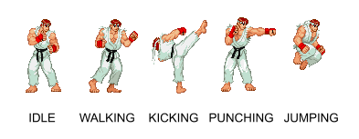
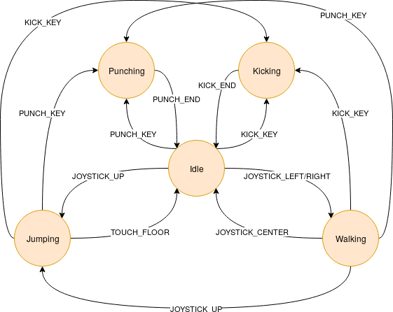

# Street Fighter

En la majoria de jocs, per a modelar el comportament dels personatges s'utilitza una **màquina d'estats**.

La màquina d'estats defineix les possibles accions que pot estar realitzant un personatge, i els events que inicien les accions. Per exemple, un jugador pot estar en estat "CAMINANT" i quan es produeix l'event en què l'usuari "POLSA LA TECLA DE DISPAR", aleshores canvia l'acció i passa a estar en estat "DISPARANT".

La cosa es complica una mica perquè hi ha estats als quals no es pot arribar partint d'altres. Per exemple, hi ha jocs en els que el personatge no pot disparar mentre esta saltant. En aquest cas no seria possible la transició directa entre l'estat "SALTANT" i l'estat "DISPARANT"·

Es demana implementar una màquina d'estats bàsica per a un personatge del joc Street Fighter:

Els **estats** possibles d'un personatge són:



Els **events** que poden canviar l'estat d'un personatge són:

- JOYSTICK_UP: El jugador ha accionat el joystick cap amunt
- JOYSTICK_LEFT/RIGHT: El jugador ha accionat el joystick a esquerra o dreta
- JOYSTICK_CENTER: El jugador a deixat el joystick al centre
- PUNCH_KEY: El jugador a polsat el botó de cop de puny
- KICK_KEY: El jugador a polsat el botó de cop de peu
- PUNCH_END: L'acció de cop de puny ha acabat
- KICK_END: L'acció de cop de peu ha acabat
- TOUCH_FLOOR: El personatge ha tocat terra

El següent diagrama ilustra les transicions entre estats que provoquen aquests events.



## Input

L'entrada consta de dues paraules:

- L'estat actual del personatge: {"IDLE", "WALK", "JUMP", "KICK", "PUNCH"}
- L'event que ha ocorregut: {"JOYSTICK_UP", "JOYSTICK_LEFT/RIGHT", "JOYSTICK_CENTER", "PUNCH_KEY", "KICK_KEY", "PUNCH_END", "KICK_END", "TOUCH_FLOOR"}

## Output

S'imprimirà l'estat en el qual quedarà el personatge.

Si l'event ocorregut no modifica l'estat, es mostrarà el que tenia abans de l'event.

## Solutions

```java
void main() {
    Scanner sc = new Scanner(System.in);
    if (!sc.hasNext()) return;
    String state = sc.next();
    String event = sc.next();

    if (state.equals("WALK")) state = "WALKING";
    if (state.equals("JUMP")) state = "JUMPING";
    if (state.equals("KICK")) state = "KICKING";
    if (state.equals("PUNCH")) state = "PUNCHING";

    String nextState = state;

    switch (state) {
        case "IDLE" -> {
            switch (event) {
                case "JOYSTICK_UP" -> nextState = "JUMPING";
                case "JOYSTICK_LEFT/RIGHT" -> nextState = "WALKING";
                case "PUNCH_KEY" -> nextState = "PUNCHING";
                case "KICK_KEY" -> nextState = "KICKING";
            }
        }
        case "WALKING" -> {
            switch (event) {
                case "JOYSTICK_UP" -> nextState = "JUMPING";
                case "JOYSTICK_CENTER" -> nextState = "IDLE";
                case "PUNCH_KEY" -> nextState = "PUNCHING";
                case "KICK_KEY" -> nextState = "KICKING";
            }
        }
        case "JUMPING" -> {
            switch (event) {
                case "TOUCH_FLOOR" -> nextState = "IDLE";
                case "PUNCH_KEY" -> nextState = "PUNCHING";
                case "KICK_KEY" -> nextState = "KICKING";
            }
        }
        case "KICKING" -> {
            if (event.equals("KICK_END")) {
                nextState = "IDLE";
            }
        }
        case "PUNCHING" -> {
            if (event.equals("PUNCH_END")) {
                nextState = "IDLE";
            }
        }
    }

    IO.println(nextState);
}
```

## Tests

### Test
```input
IDLE JOYSTICK_UP
```
```output
JUMPING
```
#### Explanation
El personatge es troba en estat "IDLE" i ocorre l'event "JOYSTICK_UP".
El nou estat passa a ser "JUMPING"

### Test
```input
IDLE JOYSTICK_UP
```
```output
JUMPING
```
#### Explanation
El personatge es troba en estat "IDLE" i ocorre l'event "JOYSTICK_LEFT/RIGHT".
El nou estat passa a ser "WALKING"

### Test
```input
IDLE JOYSTICK_LEFT/RIGHT
```
```output
WALKING
```
#### Explanation
L'estat del personatge és "IDLE" i ocorre l'event "JOYSTICK_CENTER".
Aquest event **no** modifica l'estat del personatge.

### Test
```input
IDLE JOYSTICK_CENTER
```
```output
IDLE
```

### Test
```input
IDLE PUNCH_KEY
```
```output
PUNCHING
```

### Test
```input
IDLE KICK_KEY
```
```output
KICKING
```

### Test
```input
IDLE PUNCH_END
```
```output
IDLE
```

### Test
```input
IDLE KICK_END
```
```output
IDLE
```

### Test
```input
IDLE TOUCH_FLOOR
```
```output
IDLE
```

### Test
```input
WALKING JOYSTICK_UP
```
```output
JUMPING
```

### Test
```input
WALKING JOYSTICK_LEFT/RIGHT
```
```output
WALKING
```

### Test
```input
WALKING JOYSTICK_CENTER
```
```output
IDLE
```

### Test
```input
WALKING PUNCH_KEY
```
```output
PUNCHING
```

### Test
```input
WALKING KICK_KEY
```
```output
KICKING
```

### Test
```input
WALKING PUNCH_END
```
```output
WALKING
```

### Test
```input
WALKING KICK_END
```
```output
WALKING
```

### Test
```input
WALKING TOUCH_FLOOR
```
```output
WALKING
```

### Test
```input
JUMPING JOYSTICK_UP
```
```output
JUMPING
```

### Test
```input
JUMPING JOYSTICK_LEFT/RIGHT
```
```output
JUMPING
```

### Test
```input
JUMPING JOYSTICK_CENTER
```
```output
JUMPING
```

### Test
```input
JUMPING PUNCH_KEY
```
```output
PUNCHING
```

### Test
```input
JUMPING KICK_KEY
```
```output
KICKING
```

### Test
```input
JUMPING PUNCH_END
```
```output
JUMPING
```

### Test
```input
JUMPING KICK_END
```
```output
JUMPING
```

### Test
```input
JUMPING TOUCH_FLOOR
```
```output
IDLE
```

### Test
```input
KICKING JOYSTICK_UP
```
```output
KICKING
```

### Test
```input
KICKING JOYSTICK_LEFT/RIGHT
```
```output
KICKING
```

### Test
```input
KICKING JOYSTICK_CENTER
```
```output
KICKING
```

### Test
```input
KICKING PUNCH_KEY
```
```output
KICKING
```

### Test
```input
KICKING KICK_KEY
```
```output
KICKING
```

### Test
```input
KICKING PUNCH_END
```
```output
KICKING
```

### Test
```input
KICKING KICK_END
```
```output
IDLE
```

### Test
```input
KICKING TOUCH_FLOOR
```
```output
KICKING
```

### Test
```input
PUNCHING JOYSTICK_UP
```
```output
PUNCHING
```

### Test
```input
PUNCHING JOYSTICK_LEFT/RIGHT
```
```output
PUNCHING
```

### Test
```input
PUNCHING JOYSTICK_CENTER
```
```output
PUNCHING
```

### Test
```input
PUNCHING PUNCH_KEY
```
```output
PUNCHING
```

### Test
```input
PUNCHING KICK_KEY
```
```output
PUNCHING
```

### Test
```input
PUNCHING PUNCH_END
```
```output
IDLE
```

### Test
```input
PUNCHING KICK_END
```
```output
PUNCHING
```

### Test private
```input
PUNCHING TOUCH_FLOOR
```
```output
PUNCHING
```
