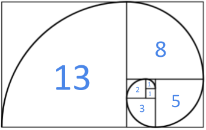

# Successió de Fibonacci

La successió de Fibonacci comença amb els nombres 0 i 1, i a partir d'aquests, «cada terme és la suma dels dos anteriors». 



Determina si una seqüència de nombres és una successió de Fibonacci.

## Input

Una seqüència de N nombres enters. La seqüència acaba amb un -1.

## Output

"SI" o "NO"

## Solutions

```java
void main() {
    Scanner sc = new Scanner(System.in);
    int count = 0;
    boolean ok = true;
    int prev2 = 0;
    int prev1 = 0;

    while (sc.hasNextInt()) {
        int x = sc.nextInt();
        if (x == -1) break;
        count++;
        if (count == 1) {
            if (x != 0) ok = false;
            prev2 = x;
        } else if (count == 2) {
            if (x != 1) ok = false;
            prev1 = x;
        } else {
            if (x != prev1 + prev2) {
                ok = false;
            }
            prev2 = prev1;
            prev1 = x;
        }
    }

    if (count < 2) ok = false;
    IO.println(ok ? "SI" : "NO");
}
```

## Tests

### Test
```input
0 1    -1
```
```output
SI
```

### Test
```input
0 1 2     -1
```
```output
NO
```

### Test
```input
0 1 1 2 3 5 8 13 21 34      -1
```
```output
SI
```

### Test
```input
0 1 1    -1
```
```output
SI
```

### Test
```input
0 1 1 2 3 4     -1
```
```output
NO
```

### Test
```input
5 6 11 17 28   -1
```
```output
NO
```

### Test
```input
0 2 2 4 6 10 -1
```
```output
NO
```

### Test private
```input
0 0 0 0 0 -1
```
```output
NO
```
