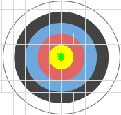
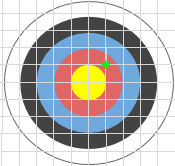
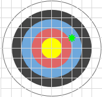
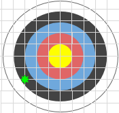
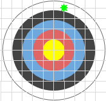
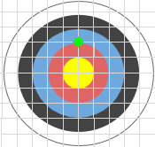

# Tir amb arc

A l'esport de tir amb arc un arquer obté una puntuació segons l'anell on clava la fletxa.
En una diana com la aquesta, rebria 5 punts al color groc, 4 al vermell, 3 al blau, 2 al negre i 1 al blanc.


L'anell groc té un radi de 5cm, i cada anell és 5cm més gran.

Si el tir cau justament sobre el límit d'un anell, es considera que la puntuació és la que correspon a l'anell de menys puntuació.

## Input

La entrada consta de 2 nombres decimals (X, Y) que indiquen la posició on s'ha clavat la fletxa respecte al centre de la diana (0,0).

## Output

S'imprimirà la puntuació obtinguda amb el tir.

## Solutions

```java
void main() {
    Scanner sc = new Scanner(System.in);
    if (!sc.hasNextDouble()) return;
    double x = sc.nextDouble();
    double y = sc.nextDouble();

    double d2 = x * x + y * y;
    if (d2 < 25.0) {
        IO.println(5);
    } else if (d2 < 100.0) {
        IO.println(4);
    } else if (d2 < 225.0) {
        IO.println(3);
    } else if (d2 < 400.0) {
        IO.println(2);
    } else if (d2 < 625.0) {
        IO.println(1);
    } else {
        IO.println(0);
    }
}
```

## Tests

### Test
```input
0 0
```
```output
5
```
#### Explanation
Just al centre de la diana són 5 punts



### Test
```input
0 0
```
```output
5
```
#### Explanation


### Test
```input
5 5
```
```output
4
```
#### Explanation


### Test
```input
10 5
```
```output
3
```
#### Explanation


### Test
```input
-15 -10
```
```output
2
```
#### Explanation


### Test
```input
20 5
```
```output
1
```
#### Explanation
Ha fet diana just al límit entre l'anell vermell i el blau, per tant es compta la puntuació del blau.



### Test
```input
0 10
```
```output
3
```

### Test
```input
0.1 24.9
```
```output
1
```

### Test
```input
7.1 7.9
```
```output
3
```

### Test
```input
20 0
```
```output
1
```

### Test private
```input
-2.67 4.89
```
```output
4
```
