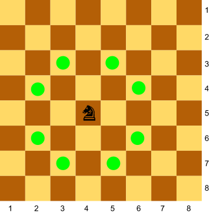
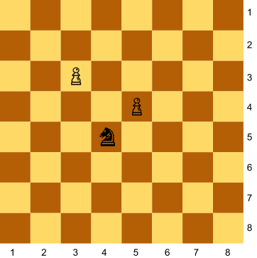
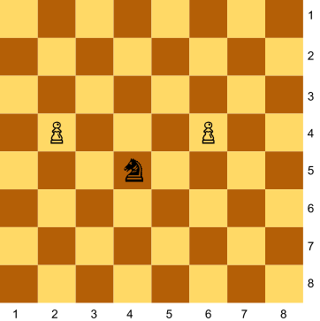
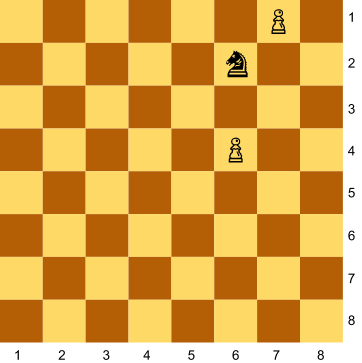
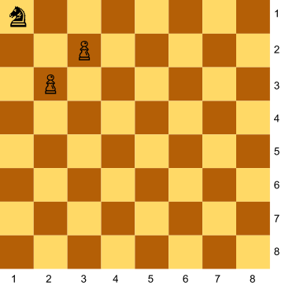
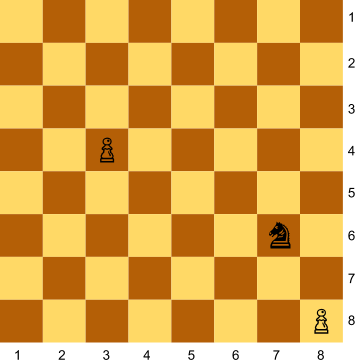

# Un cavall contra dos peons

Als escacs el cavall pot saltar fent una "L", així:



Donada la posició d'un cavall i de dos peons al tauler, digues quants peons està amenaçant el cavall.

## Input

La posició del cavall, i del dos peons

## Output

0 | 1 | 2

## Solutions

```java
void main() {
    Scanner sc = new Scanner(System.in);
    int kr = sc.nextInt();
    int kc = sc.nextInt();
    int p1r = sc.nextInt();
    int p1c = sc.nextInt();
    int p2r = sc.nextInt();
    int p2c = sc.nextInt();

    int count = 0;
    if (Math.abs(kr - p1r) * Math.abs(kc - p1c) == 2) {
        count++;
    }
    if (Math.abs(kr - p2r) * Math.abs(kc - p2c) == 2) {
        count++;
    }

    IO.println(count);
}
```

## Tests

### Test
```input
4 5
3 3
5 4
```
```output
1
```
#### Explanation


### Test
```input
4 5
3 3
5 4
```
```output
1
```
#### Explanation


### Test
```input
4 5
2 4
6 4
```
```output
2
```
#### Explanation


### Test
```input
6 2
6 4
7 1
```
```output
0
```
#### Explanation


### Test
```input
1 1
2 3
3 2
```
```output
2
```
#### Explanation


### Test
```input
7 6
3 4
8 8
```
```output
1
```

### Test
```input
3 5
2 2
1 1
```
```output
0
```

### Test private
```input
8 2
7 4
5 3
```
```output
1
```
