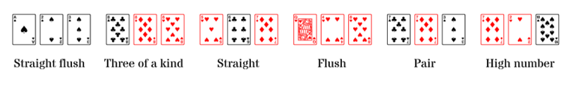

# Three card poker



Al Three Card Poker es poden fer les següents figures:

- **Straight flush**: 3 cartes amb números consecutius del mateix pal
- **Three of a kind**: 3 cartes del mateix número
- **Straight**: 3 cartes amb números consecutius
- **Flush**: 3 cartes del mateix pal
- **Pair**: 2 cartes del mateix número
- **High number**: cap de les anteriors

En la nostra versió del joc, jugarem només amb els números, no amb els pals. Així, les figures possibles seran:

- **Three of a kind**
- **Straight**
- **Pair**
- **High number**

## Input

L'entrada consta de 3 números enters corresponents als números de les cartes.

## Output

S'imprimirà la figura de més valor. 

`THREE OF A KIND` | `STRAIGHT` | `PAIR` | `HIGH NUMBER`

## Solutions

```java
void main() {
    Scanner sc = new Scanner(System.in);
    int a = sc.nextInt();
    int b = sc.nextInt();
    int c = sc.nextInt();

    int min = Math.min(a, Math.min(b, c));
    int max = Math.max(a, Math.max(b, c));
    int mid = a + b + c - min - max;

    if (a == b && b == c) {
        IO.println("THREE OF A KIND");
    } else if (mid == min + 1 && max == mid + 1) {
        IO.println("STRAIGHT");
    } else if (a == b || b == c || a == c) {
        IO.println("PAIR");
    } else {
        IO.println("HIGH CARD");
    }
}
```

## Tests

### Test
```input
1 1 1
```
```output
THREE OF A KIND
```

### Test
```input
1 1 1
```
```output
THREE OF A KIND
```

### Test
```input
1 1 2
```
```output
PAIR
```

### Test
```input
1 1 3
```
```output
PAIR
```

### Test
```input
1 1 4
```
```output
PAIR
```

### Test
```input
1 2 1
```
```output
PAIR
```

### Test
```input
1 2 2
```
```output
PAIR
```

### Test
```input
1 2 3
```
```output
STRAIGHT
```

### Test
```input
1 2 4
```
```output
HIGH CARD
```

### Test
```input
1 3 1
```
```output
PAIR
```

### Test
```input
1 3 2
```
```output
STRAIGHT
```

### Test
```input
1 3 3
```
```output
PAIR
```

### Test
```input
1 3 4
```
```output
HIGH CARD
```

### Test
```input
1 4 1
```
```output
PAIR
```

### Test
```input
1 4 2
```
```output
HIGH CARD
```

### Test
```input
1 4 3
```
```output
HIGH CARD
```

### Test
```input
1 4 4
```
```output
PAIR
```

### Test
```input
2 1 1
```
```output
PAIR
```

### Test
```input
2 1 2
```
```output
PAIR
```

### Test
```input
2 1 3
```
```output
STRAIGHT
```

### Test
```input
2 1 4
```
```output
HIGH CARD
```

### Test
```input
2 2 1
```
```output
PAIR
```

### Test
```input
2 2 2
```
```output
THREE OF A KIND
```

### Test
```input
2 2 3
```
```output
PAIR
```

### Test
```input
2 2 4
```
```output
PAIR
```

### Test
```input
2 3 1
```
```output
STRAIGHT
```

### Test
```input
2 3 2
```
```output
PAIR
```

### Test
```input
2 3 3
```
```output
PAIR
```

### Test
```input
2 3 4
```
```output
STRAIGHT
```

### Test
```input
2 4 1
```
```output
HIGH CARD
```

### Test
```input
2 4 2
```
```output
PAIR
```

### Test
```input
2 4 3
```
```output
STRAIGHT
```

### Test
```input
2 4 4
```
```output
PAIR
```

### Test
```input
3 1 1
```
```output
PAIR
```

### Test
```input
3 1 2
```
```output
STRAIGHT
```

### Test
```input
3 1 3
```
```output
PAIR
```

### Test
```input
3 1 4
```
```output
HIGH CARD
```

### Test
```input
3 2 1
```
```output
STRAIGHT
```

### Test
```input
3 2 2
```
```output
PAIR
```

### Test
```input
3 2 3
```
```output
PAIR
```

### Test
```input
3 2 4
```
```output
STRAIGHT
```

### Test
```input
3 3 1
```
```output
PAIR
```

### Test
```input
3 3 2
```
```output
PAIR
```

### Test
```input
3 3 3
```
```output
THREE OF A KIND
```

### Test
```input
3 3 4
```
```output
PAIR
```

### Test
```input
3 4 1
```
```output
HIGH CARD
```

### Test
```input
3 4 2
```
```output
STRAIGHT
```

### Test
```input
3 4 3
```
```output
PAIR
```

### Test
```input
3 4 4
```
```output
PAIR
```

### Test
```input
4 1 1
```
```output
PAIR
```

### Test
```input
4 1 2
```
```output
HIGH CARD
```

### Test
```input
4 1 3
```
```output
HIGH CARD
```

### Test
```input
4 1 4
```
```output
PAIR
```

### Test
```input
4 2 1
```
```output
HIGH CARD
```

### Test
```input
4 2 2
```
```output
PAIR
```

### Test
```input
4 2 3
```
```output
STRAIGHT
```

### Test
```input
4 2 4
```
```output
PAIR
```

### Test
```input
4 3 1
```
```output
HIGH CARD
```

### Test
```input
4 3 2
```
```output
STRAIGHT
```

### Test
```input
4 3 3
```
```output
PAIR
```

### Test
```input
4 3 4
```
```output
PAIR
```

### Test
```input
4 4 1
```
```output
PAIR
```

### Test
```input
4 4 2
```
```output
PAIR
```

### Test
```input
4 4 3
```
```output
PAIR
```

### Test private
```input
4 4 4
```
```output
THREE OF A KIND
```
