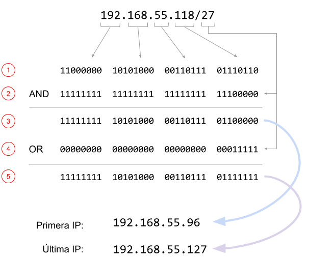

# Xarxes privades

A l'arquitectura d'adreçament d'Internet, una xarxa privada és una xarxa que utilitza l'espai d'adreces IP privades:

- 10.0.0.0 - 10.255.255.255
- 172.16.0.0 - 172.31.255.255
- 192.168.0.0 - 192.168.255.255

Les adreces privades no s'asignen a cap organització concreta i qualsevol persona pot utilitzar aquestes adreces sense l'aprovació d'un Registre Regional d'Internet.

La xarxa a la que pertany un ordinador es calcula a partir de la seva IP i la seva màscara de xarxa:

1. Es passa cada nombre de la ip a un octet binari, i es coloquen consecutivament els quatre octets.
2. Es crea un nombre binari amb tants 1 com indica la màscara i es completa amb 0 fins a 32 bits.
3. Es realitza la operació AND entre el primer i el segon nombre. El valor resultant és la IP on comença la xarxa
4. Es crea un nombre binari amb tants 0 com indica la màscara i es completa amb 1 fins a 32 bits.
5. Es realitza la operació OR entre el primer i el segon nombre. El valor resultant és la IP on acaba la xarxa



## Input

La entrada consta dels quatre octets d'una adreça IP i una màscara de xarxa, separats per espais en blanc.

## Output

S'imprimirà la primera adreça de la xarxa, la última adreça, i s'indicarà si és una adreça pública o privada.

## Solutions

```java
void main() {
    Scanner sc = new Scanner(System.in);
    if (!sc.hasNextInt()) return;
    int[] ip = new int[4];
    for (int i = 0; i < 4; i++) {
        ip[i] = sc.nextInt();
    }
    int mask = sc.nextInt();

    int[] first = new int[4];
    int[] last = new int[4];

    for (int k = 0; k < 4; k++) {
        int bits;
        if (mask >= (k + 1) * 8) {
            bits = 8;
        } else if (mask <= k * 8) {
            bits = 0;
        } else {
            bits = mask - k * 8;
        }

        int blockSize = 1;
        for (int i = 0; i < 8 - bits; i++) {
            blockSize *= 2;
        }

        first[k] = (ip[k] / blockSize) * blockSize;
        last[k] = first[k] + blockSize - 1;
    }

    IO.println("First IP: " + first[0] + "." + first[1] + "." + first[2] + "." + first[3]);
    IO.println("Last IP: " + last[0] + "." + last[1] + "." + last[2] + "." + last[3]);

    boolean isPrivate = false;
    if (first[0] == 10 && last[0] == 10) {
        isPrivate = true;
    } else if (first[0] == 172 && last[0] == 172 && first[1] >= 16 && last[1] <= 31) {
        isPrivate = true;
    } else if (first[0] == 192 && last[0] == 192 && first[1] == 168 && last[1] == 168) {
        isPrivate = true;
    }

    if (isPrivate) {
        IO.println("Private");
    } else {
        IO.println("Public");
    }
}
```

## Tests

### Test
```input
192 168 55 118
11
```
```output
First IP: 192.160.0.0
Last IP: 192.191.255.255
Public
```

### Test
```input
192 168 55 118
24
```
```output
First IP: 192.168.55.0
Last IP: 192.168.55.255
Private
```

### Test
```input
192 168 55 118
11
```
```output
First IP: 192.160.0.0
Last IP: 192.191.255.255
Public
```

### Test
```input
10 2 2 1
11
```
```output
First IP: 10.0.0.0
Last IP: 10.31.255.255
Private
```

### Test
```input
172 16 2 1
22
```
```output
First IP: 172.16.0.0
Last IP: 172.16.3.255
Private
```

### Test
```input
35 16 23 214
24
```
```output
First IP: 35.16.23.0
Last IP: 35.16.23.255
Public
```

### Test
```input
35 16 23 214
8
```
```output
First IP: 35.0.0.0
Last IP: 35.255.255.255
Public
```

### Test
```input
8 8 8 8
30
```
```output
First IP: 8.8.8.8
Last IP: 8.8.8.11
Public
```

### Test
```input
172 32 16 0
12
```
```output
First IP: 172.32.0.0
Last IP: 172.47.255.255
Public
```

### Test
```input
172 15 255 0
22
```
```output
First IP: 172.15.252.0
Last IP: 172.15.255.255
Public
```

### Test
```input
10 0 0 1
6
```
```output
First IP: 8.0.0.0
Last IP: 11.255.255.255
Public
```

### Test private
```input
235 84 63 17
19
```
```output
First IP: 235.84.32.0
Last IP: 235.84.63.255
Public
```
